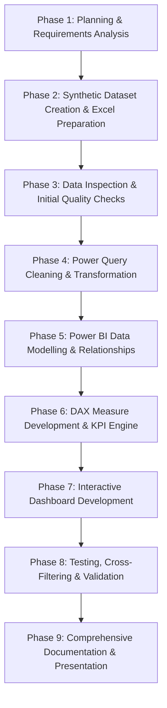

# Project Implementation Phases

---

## Detailed Phase Breakdown

### Phase 1: Project Planning & Requirements Analysis
- Define project identity, industry scenario (electronics component distributor/manufacturing enterprise), and target user personas (Inventory and Procurement managers).
- Establish core analytical objectives across Module A (Inventory Analytics) and Module B (Procurement Analytics).
- Formulate 18 specific business questions with detailed requirements mapping (inputs, calculations, outputs).
- Define project scope boundaries, distinguishing in-scope analytics from out-of-scope ERP transaction processing.

### Phase 2: Synthetic Dataset Creation & Excel Workbook Preparation
- Architect a normalized relational structure across 6 logical worksheets in Microsoft Excel (`electronics_inventory_raw.xlsx`):
  - `Categories`: 8 component categories.
  - `Components`: 105 distinct electronic parts with standard benchmark costs in Indian Rupee (₹).
  - `Suppliers`: 50 commercial suppliers distributed across Indian electronics manufacturing hubs.
  - `InventorySnapshots`: 1,260 monthly stock observations across all 12 calendar months in 2025.
  - `PurchaseOrders`: 100 purchase order headers tracking order dates, delivery milestones, and fulfillment statuses (80 Delivered, 12 Pending, 8 Cancelled).
  - `PurchaseOrderDetails`: 125 purchase order line items recording ordered quantities and actual purchase costs in Rupee (₹).
- Standardize all quantities to `Piece` and enforce realistic market price variances ($\pm 3\%$ to $\pm 12\%$).

### Phase 3: Data Inspection & Initial Quality Checks
- Conduct baseline audits on the Excel worksheets for structural completeness.
- Verify primary key uniqueness across all entity identifiers (`CAT###`, `CMP###`, `SUP###`, `INV####`, `PO###`, `POL####`).
- Validate referential foreign key connections to ensure no orphan records exist.
- Confirm business rule compliance: `ActualDeliveryDate` is populated for all `Delivered` orders and left blank for `Pending` and `Cancelled` orders.

### Phase 4: Power Query Cleaning & Transformation (ETL)
- Ingest the 6 Excel worksheets into the Power Query environment.
- Enforce explicit data types (Text for IDs/names, Date for milestones, Whole Number for quantities, Decimal Number for costs/valuations, Logical for Booleans).
- Handle legitimate null values without inserting false zeros or placeholder dates.
- Standardize text formatting, trim whitespace, and normalize casing.
- Document the end-to-end M-language transformation pipeline.

### Phase 5: Power BI Data Modelling & Relationships
- Import cleansed tables into Microsoft Power BI Desktop.
- Construct a star/snowflake schema with single-direction filter propagation:
  - `Categories` (1) $\rightarrow$ `Components` (N)
  - `Components` (1) $\rightarrow$ `InventorySnapshots` (N)
  - `Components` (1) $\rightarrow$ `PurchaseOrderDetails` (N)
  - `Suppliers` (1) $\rightarrow$ `PurchaseOrders` (N)
  - `PurchaseOrders` (1) $\rightarrow$ `PurchaseOrderDetails` (N)
- Hide foreign keys in reporting view to prevent erroneous summarization.
- Implement an analytical DAX Date table supporting time intelligence, monthly trends, and date slicers.

### Phase 6: DAX Measure Development & KPI Engine
- Author foundational DAX measures (Total Components, Total Stock Quantity, Total PO Spend, Total Units Ordered).
- Implement business logic measures:
  - Inventory Valuation: `SUMX(InventorySnapshots, QuantityOnHand * RELATED(Components[StandardUnitCost]))`
  - Stock Health Conditions: `Zero Stock Components` (`QuantityOnHand = 0`) and `Low Stock Components` (`QuantityOnHand > 0 && QuantityOnHand < ReorderLevel`).
  - Delivery Lead Time: `AVERAGEX(..., DATEDIFF(OrderDate, ActualDeliveryDate, DAY))`.
  - On-Time Delivery Rate: `DIVIDE(On-Time Delivered Orders, Delivered Orders, 0)`.
  - Supplier Price Variance percentage against standard benchmark costs.
- Organize measures into dedicated display folders.

### Phase 7: Interactive Dashboard Development
- Design and build **Page 1: Inventory Analytics Dashboard**:
  - Executive KPI cards for valuation, piece count, zero stock, and low stock warnings.
  - Clustered bar chart showing category-wise piece volume and inventory value.
  - Area chart displaying monthly stock progression across 2025.
  - Critical stock reorder table with bin locations and deficit quantities.
- Design and build **Page 2: Procurement Analytics Dashboard**:
  - Executive KPI cards for total spend, order counts, lead time, and OTD %.
  - Column chart showing monthly purchasing spend trends.
  - Scatter plot analyzing supplier spend vs delivery lead times.
  - Donut visual displaying order status distribution (80/12/8).
  - Component purchase frequency vs volume matrix.
- Configure slicers (Snapshot Date, Order Date, Category, Supplier, Status) and cross-filtering.

### Phase 8: Testing, Cross-Filtering & Validation
- Validate KPI calculations against raw Excel aggregations to ensure 100% mathematical accuracy.
- Test visual cross-filtering and drill-through behavior across slicers.
- Verify that filtering by snapshot date correctly isolates inventory observations without double counting across months.
- Ensure pending and cancelled orders are treated correctly in procurement spend and lead time calculations.

### Phase 9: Comprehensive Documentation & Final Presentation
- Update all repository Markdown files to reflect the pure Excel + Power Query + Power BI architecture.
- Compile technical data dictionary, transformation documentation, and DAX catalog.
- Document data quality findings, analytical insights, strategic recommendations, and limitations.
- Prepare stakeholder presentation slide decks in `06_Presentation/`.
