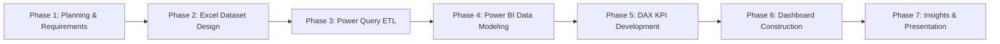

# Project Phases

## Implementation Phases

### Phase 1: Planning and Requirements
- Document project overview, industry scenario, problem statement, and scope boundaries.
- Formulate 18 specific business questions across Inventory and Procurement modules.
- Define core KPIs and target reporting metrics.

### Phase 2: Synthetic Dataset Design & Creation
- Design relational schema across 6 normalized tables.
- Generate fictional synthetic records in Microsoft Excel (`electronics_inventory_raw.xlsx`):
  - 8 Categories
  - 105 Components (with standard unit costs in INR ₹)
  - 50 Suppliers (across Indian industrial hubs)
  - 1,260 Inventory Snapshots (12 monthly intervals in 2025)
  - 100 Purchase Orders (headers with dates and statuses)
  - 125 Purchase Order Details (line items with purchase prices in INR ₹)

### Phase 3: Data Transformation & ETL (Power Query)
- Ingest Excel sheets into Power Query.
- Enforce correct data types (Dates, Decimals, Whole Numbers, Text, Booleans).
- Handle nullable fields (`ActualDeliveryDate` for pending/cancelled orders).
- Clean and trim text columns and validate referential keys.

### Phase 4: Power BI Data Modeling & Relationships
- Build Star/Snowflake schema data model.
- Configure 1-to-many single-direction relationships between dimensions and facts.
- Hide foreign keys in reporting view to prevent incorrect aggregations.

### Phase 5: DAX Measure & Calculation Development
- Author foundational measures (Total Stock, Inventory Valuation, PO Committed Spend).
- Implement operational logic (Zero-Stock Count, Low-Stock Count, Delivery Lead Time, On-Time Delivery %).
- Build dynamic category-level and supplier-level aggregations.

### Phase 6: Interactive Dashboard Construction
- Develop the **Inventory Analytics Dashboard** (stock health gauges, valuation cards, category breakdown, monthly trends).
- Develop the **Procurement Analytics Dashboard** (spend by vendor, order fulfillment pipeline, lead-time distributions, OTD % KPIs).
- Implement interactive slicers, cross-filtering, and tooltips.

### Phase 7: Business Insights & Presentation
- Audit data quality across the pipeline.
- Compile key analytical findings and strategic management recommendations.
- Finalize executive presentation slides and comprehensive documentation.
