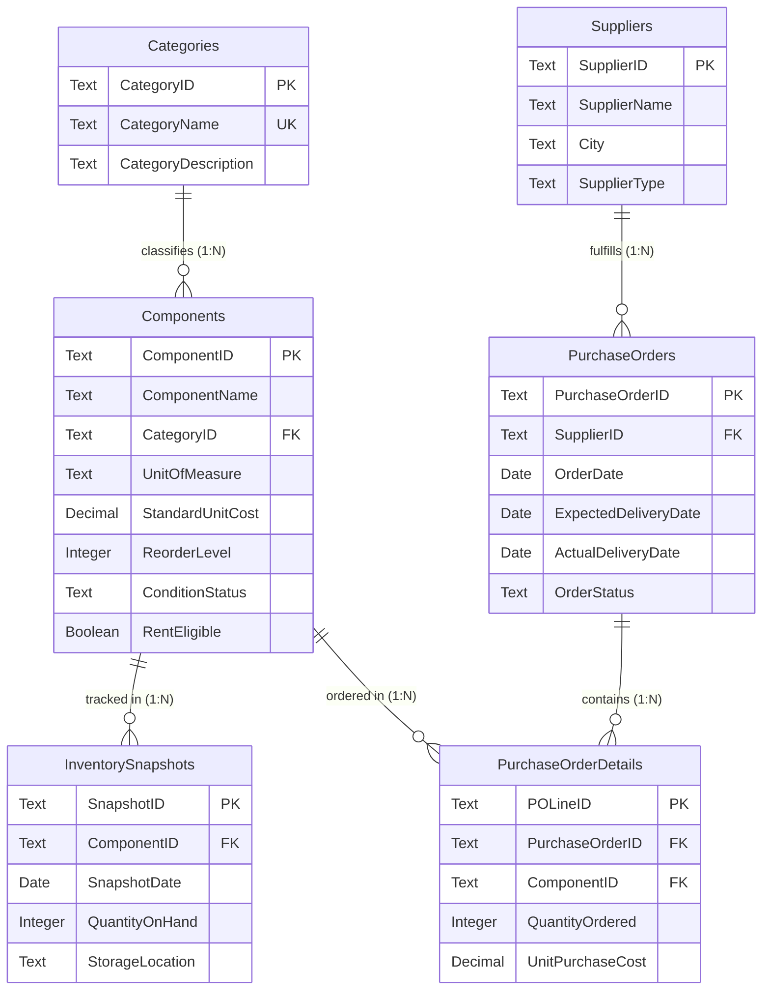

# Data Dictionary & Schema Specification

## Dataset Overview
- **Source File**: Microsoft Excel Workbook (`02_Dataset/raw/electronics_inventory_raw.xlsx`) containing 6 separate worksheets.
- **Data Authenticity**: 100% synthetic dataset created specifically for this project. No real company or college data is used.
- **Reporting Currency**: Indian Rupee (INR - ₹).
- **Unit of Measurement (UoM)**: Standardized to **Piece** for all components so that total stock quantity aggregation is mathematically valid.

### Dataset Sizing

| Worksheet / Table | Description | Total Records | Primary Key | Key Relationships |
| :--- | :--- | :---: | :---: | :--- |
| **`Categories`** | Component categories master | **8** | `CategoryID` | Classifies `Components` (1:N) |
| **`Components`** | Master component catalogue | **105** | `ComponentID` | Referenced by `InventorySnapshots` & `PurchaseOrderDetails` |
| **`Suppliers`** | Vendor and supplier profiles | **50** | `SupplierID` | Fulfills `PurchaseOrders` (1:N) |
| **`InventorySnapshots`** | Monthly stock observations | **1,260** | `SnapshotID` | Tracks `Components` across 12 monthly dates |
| **`PurchaseOrders`** | Purchase order headers | **100** | `PurchaseOrderID` | Header for `PurchaseOrderDetails` (1:N) |
| **`PurchaseOrderDetails`**| Purchase order line items | **125** | `POLineID` | Detailed parts ordered per PO |

---

## Component Categories
The catalog encompasses eight primary electronic component categories:
1. **Passive Components** (Resistors, Capacitors, Inductors)
2. **Diodes and LEDs** (Rectifier diodes, Zener diodes, signal diodes, LEDs)
3. **Transistors and MOSFETs** (BJT, Power MOSFETs, Darlington pairs)
4. **Integrated Circuits** (Operational Amplifiers, Timers, Voltage Regulators, Logic ICs)
5. **Sensors** (Temperature, Ultrasonic, Light, Motion, Gas sensors)
6. **Microcontrollers and Development Boards** (Microcontrollers, Dev boards, evaluation kits)
7. **Connectors and Cables** (Terminal blocks, Pin headers, Cable assemblies, USB receptacles)
8. **Electromechanical Components** (Relays, Switches, Buzzers, Cooling fans)

---

## Entity-Relationship Model

---

## Table Specifications

### Table 1: Categories
**Purpose**: Maintain the electronic component categories.

| Column | Data Type | Constraint | Description | Example |
| :--- | :--- | :---: | :--- | :--- |
| `CategoryID` | Text | **PK** | Unique identifier for category | `CAT001` |
| `CategoryName` | Text | **UNIQUE** | Descriptive category name | `Passive Components` |
| `CategoryDescription` | Text | — | Description of components within category | `Non-amplifying electronic components...` |

---

### Table 2: Components
**Purpose**: Maintain the master component catalog.

| Column | Data Type | Constraint | Description | Example |
| :--- | :--- | :---: | :--- | :--- |
| `ComponentID` | Text | **PK** | Unique component identifier | `CMP001` |
| `ComponentName` | Text | — | Component descriptive name and specification | `10k Ohm 1/4W Metal Film Resistor 1%` |
| `CategoryID` | Text | **FK** | Foreign key to `Categories(CategoryID)` | `CAT001` |
| `UnitOfMeasure` | Text | — | Unit of measure (`Piece`) | `Piece` |
| `StandardUnitCost` | Decimal (2 dec) | — | Benchmark reference cost in Rupee (₹) | `0.80` |
| `ReorderLevel` | Integer | — | Minimum stock threshold triggering reorder | `500` |
| `ConditionStatus` | Text | — | Physical condition (`New`, `Refurbished`) | `New` |
| `RentEligible` | Boolean | — | Commercial rental eligibility (`TRUE` / `FALSE`) | `FALSE` |

> **Valuation Note**: `StandardUnitCost` is the benchmark cost used for inventory holding valuation. It is tracked separately from historical procurement costs recorded in `PurchaseOrderDetails`.

---

### Table 3: Suppliers
**Purpose**: Maintain vendor and supplier profiles.

| Column | Data Type | Constraint | Description | Example |
| :--- | :--- | :---: | :--- | :--- |
| `SupplierID` | Text | **PK** | Unique supplier identifier | `SUP001` |
| `SupplierName` | Text | — | Fictional supplier company name | `ElectroVibe Components Pvt Ltd` |
| `City` | Text | — | Supplier industrial hub / city | `Bengaluru` |
| `SupplierType` | Text | — | Classification (`Authorized Distributor`, `Direct OEM`, etc.) | `Authorized Distributor` |

---

### Table 4: InventorySnapshots
**Purpose**: Record monthly inventory observations per component across 2025.

| Column | Data Type | Constraint | Description | Example |
| :--- | :--- | :---: | :--- | :--- |
| `SnapshotID` | Text | **PK** | Unique snapshot observation identifier | `INV0001` |
| `ComponentID` | Text | **FK** | Foreign key to `Components(ComponentID)` | `CMP001` |
| `SnapshotDate` | Date (YYYY-MM-DD)| — | Monthly observation date (end of month) | `2025-01-31` |
| `QuantityOnHand` | Integer | — | Counted physical stock in pieces | `1,289` |
| `StorageLocation` | Text | — | Assigned warehouse bin or aisle | `Aisle-A-Bin01` |

> **Snapshot Integrity Rule**: Strictly one observation per component per month, spanning all 12 months in 2025 (105 components × 12 months = 1,260 rows).

---

### Table 5: PurchaseOrders
**Purpose**: Maintain purchase order headers and fulfillment tracking.

| Column | Data Type | Constraint | Description | Example |
| :--- | :--- | :---: | :--- | :--- |
| `PurchaseOrderID` | Text | **PK** | Unique purchase order identifier | `PO001` |
| `SupplierID` | Text | **FK** | Foreign key to `Suppliers(SupplierID)` | `SUP034` |
| `OrderDate` | Date (YYYY-MM-DD)| — | Date the PO was placed | `2025-01-05` |
| `ExpectedDeliveryDate`| Date (YYYY-MM-DD)| — | Committed vendor delivery date | `2025-01-19` |
| `ActualDeliveryDate` | Date (YYYY-MM-DD)| Nullable | Physical receipt date (*blank for Pending/Cancelled*) | `2025-01-13` |
| `OrderStatus` | Text | — | Order status (`Delivered`, `Pending`, `Cancelled`) | `Delivered` |

> **Order Fulfillment Business Rules**:
> - Allowed statuses: `Delivered`, `Pending`, `Cancelled`.
> - For `Delivered` orders, `ActualDeliveryDate` is always populated.
> - For `Pending` and `Cancelled` orders, `ActualDeliveryDate` is empty (`null`).

---

### Table 6: PurchaseOrderDetails
**Purpose**: Store component-level line items for each purchase order.

| Column | Data Type | Constraint | Description | Example |
| :--- | :--- | :---: | :--- | :--- |
| `POLineID` | Text | **PK** | Unique line item identifier | `POL0001` |
| `PurchaseOrderID` | Text | **FK** | Foreign key to `PurchaseOrders(PurchaseOrderID)` | `PO001` |
| `ComponentID` | Text | **FK** | Foreign key to `Components(ComponentID)` | `CMP082` |
| `QuantityOrdered` | Integer | — | Number of units ordered in pieces | `200` |
| `UnitPurchaseCost` | Decimal (2 dec) | — | Actual negotiated purchase price in Rupee (₹) | `7.24` |

---

## Relational Cardinality & Model Mapping

| Parent Table | Child Table | Relationship Type | Foreign Key | Cross-Filter Direction in Power BI |
| :--- | :--- | :---: | :--- | :---: |
| `Categories` | `Components` | 1-to-Many ($1 : N$) | `Components[CategoryID]` | Single (`Categories` filters `Components`) |
| `Components` | `InventorySnapshots` | 1-to-Many ($1 : N$) | `InventorySnapshots[ComponentID]` | Single (`Components` filters `Snapshots`) |
| `Components` | `PurchaseOrderDetails` | 1-to-Many ($1 : N$) | `PurchaseOrderDetails[ComponentID]` | Single (`Components` filters `Details`) |
| `Suppliers` | `PurchaseOrders` | 1-to-Many ($1 : N$) | `PurchaseOrders[SupplierID]` | Single (`Suppliers` filters `Orders`) |
| `PurchaseOrders` | `PurchaseOrderDetails` | 1-to-Many ($1 : N$) | `PurchaseOrderDetails[PurchaseOrderID]` | Single (`PurchaseOrders` filters `Details`) |
