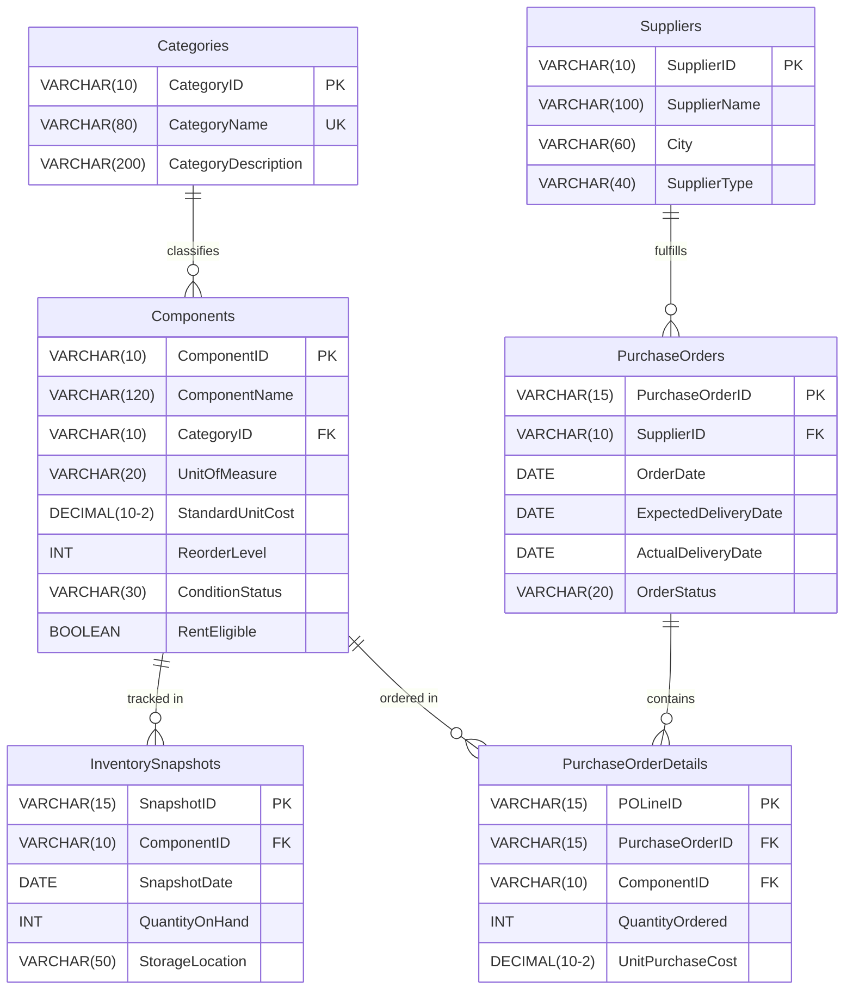

# Data Dictionary & Schema Specification

## Synthetic Dataset Design
- **Source**: 100% synthetic dataset created from scratch. No real company or college data is used.
- **Currency**: Indian Rupee (INR - ₹).
- **Unit of Measurement**: Standardized to **Piece** for all components so that total stock quantity aggregation is mathematically valid.
- **Raw File**: `electronics_inventory_raw.xlsx` (6 distinct worksheets).

### Planned Dataset Sizing
| Table / Worksheet | Description | Planned Records |
| :--- | :--- | :---: |
| **Categories** | Component categories master | 8 |
| **Components** | Component catalog master | 100 |
| **Suppliers** | Supplier and vendor master | 10 |
| **InventorySnapshots** | Monthly stock observations | 1,200 |
| **PurchaseOrders** | Purchase order headers | 120 |
| **PurchaseOrderDetails** | Component-level purchase order line items | 300 |

---

## Component Categories
The project covers eight primary electronic component categories:
1. **Passive Components** (Resistors, Capacitors, Inductors)
2. **Diodes and LEDs** (Rectifier diodes, Zener diodes, LEDs)
3. **Transistors and MOSFETs** (BJT, Power MOSFETs)
4. **Integrated Circuits** (Operational Amplifiers, Timers, Voltage Regulators)
5. **Sensors** (Temperature, Ultrasonic, Light, Motion sensors)
6. **Microcontrollers and Development Boards** (Microcontrollers, Dev boards)
7. **Connectors and Cables** (Terminal blocks, Headers, Cable assemblies)
8. **Electromechanical Components** (Relays, Switches, Buzzers)

---

## Entity-Relationship Model

---

## Exact Table Specifications

### Table 1 — Categories
**Purpose**: Maintain the different electronic component categories.

| Column | Data Type | Key | Description | Example |
| :--- | :--- | :---: | :--- | :--- |
| `CategoryID` | `VARCHAR(10)` | **PK** | Unique identifier for category | `CAT001` |
| `CategoryName` | `VARCHAR(80)` | **UNIQUE** | Descriptive category name | `Passive Components` |
| `CategoryDescription` | `VARCHAR(200)` | — | Description of category scope | `Resistors, capacitors, and inductors` |

---

### Table 2 — Components
**Purpose**: Maintain the component master catalogue.

| Column | Data Type | Key | Description | Example |
| :--- | :--- | :---: | :--- | :--- |
| `ComponentID` | `VARCHAR(10)` | **PK** | Unique component identifier | `CMP001` |
| `ComponentName` | `VARCHAR(120)` | — | Component descriptive name | `10k Ohm Resistor 1/4W` |
| `CategoryID` | `VARCHAR(10)` | **FK** | Foreign key to `Categories(CategoryID)` | `CAT001` |
| `UnitOfMeasure` | `VARCHAR(20)` | — | Unit of measure (`Piece`) | `Piece` |
| `StandardUnitCost` | `DECIMAL(10,2)` | — | Reference cost (₹) for inventory valuation | `1.50` |
| `ReorderLevel` | `INT` | — | Threshold quantity triggering reorder | `200` |
| `ConditionStatus` | `VARCHAR(30)` | — | Condition (e.g. `New`, `Refurbished`) | `New` |
| `RentEligible` | `BOOLEAN` | — | Eligible for commercial rental (`TRUE`/`FALSE`) | `FALSE` |

> **Valuation Note**: `StandardUnitCost` is the reference cost used for inventory valuation. It is separate from the actual purchase price recorded in purchase order details.

---

### Table 3 — Suppliers
**Purpose**: Maintain supplier information.

| Column | Data Type | Key | Description | Example |
| :--- | :--- | :---: | :--- | :--- |
| `SupplierID` | `VARCHAR(10)` | **PK** | Unique supplier identifier | `SUP001` |
| `SupplierName` | `VARCHAR(100)` | — | Fictional supplier name | `ElectroVibe Components Pvt Ltd` |
| `City` | `VARCHAR(60)` | — | Location city | `Bengaluru` |
| `SupplierType` | `VARCHAR(40)` | — | Supplier classification | `Authorized Distributor` |

---

### Table 4 — InventorySnapshots
**Purpose**: Record the stock quantity of each component at monthly intervals.

| Column | Data Type | Key | Description | Example |
| :--- | :--- | :---: | :--- | :--- |
| `SnapshotID` | `VARCHAR(15)` | **PK** | Unique snapshot record identifier | `INV0001` |
| `ComponentID` | `VARCHAR(10)` | **FK** | Foreign key to `Components(ComponentID)` | `CMP001` |
| `SnapshotDate` | `DATE` | — | Snapshot observation date | `2025-01-31` |
| `QuantityOnHand` | `INT` | — | Quantity in stock on snapshot date | `400` |
| `StorageLocation` | `VARCHAR(50)` | — | Warehouse bin or rack code | `Bin-A01` |

> **Uniqueness Constraint**: A composite unique constraint on `(ComponentID, SnapshotDate)` prevents duplicate monthly observations per component.

#### Example Snapshot Progression:
| SnapshotID | ComponentID | SnapshotDate | QuantityOnHand | StorageLocation |
| :--- | :--- | :---: | :---: | :--- |
| `INV0001` | `CMP001` | 2025-01-31 | 400 | Bin-A01 |
| `INV0002` | `CMP001` | 2025-02-28 | 350 | Bin-A01 |
| `INV0003` | `CMP001` | 2025-03-31 | 320 | Bin-A01 |

---

### Table 5 — PurchaseOrders
**Purpose**: Maintain purchase order information.

| Column | Data Type | Key | Description | Example |
| :--- | :--- | :---: | :--- | :--- |
| `PurchaseOrderID` | `VARCHAR(15)` | **PK** | Unique purchase order identifier | `PO001` |
| `SupplierID` | `VARCHAR(10)` | **FK** | Foreign key to `Suppliers(SupplierID)` | `SUP001` |
| `OrderDate` | `DATE` | — | Date the order was placed | `2025-01-10` |
| `ExpectedDeliveryDate` | `DATE` | — | Expected date of delivery | `2025-01-18` |
| `ActualDeliveryDate` | `DATE` | Nullable | Actual receipt date (nullable) | `2025-01-17` |
| `OrderStatus` | `VARCHAR(20)` | — | Status (`Delivered`, `Pending`, `Cancelled`) | `Delivered` |

> **Order Status Integrity Rules**:
> - Allowed statuses: `Delivered`, `Pending`, `Cancelled`.
> - For `Delivered` orders, `ActualDeliveryDate` must exist.
> - For `Pending` and `Cancelled` orders, `ActualDeliveryDate` will be blank (`NULL`).

---

### Table 6 — PurchaseOrderDetails
**Purpose**: Store the component-level details of each purchase order.

| Column | Data Type | Key | Description | Example |
| :--- | :--- | :---: | :--- | :--- |
| `POLineID` | `VARCHAR(15)` | **PK** | Unique purchase order line item ID | `POL001` |
| `PurchaseOrderID` | `VARCHAR(15)` | **FK** | Foreign key to `PurchaseOrders(PurchaseOrderID)` | `PO001` |
| `ComponentID` | `VARCHAR(10)` | **FK** | Foreign key to `Components(ComponentID)` | `CMP001` |
| `QuantityOrdered` | `INT` | — | Number of units ordered | `500` |
| `UnitPurchaseCost` | `DECIMAL(10,2)` | — | Actual negotiated price per unit (₹) | `1.80` |

#### Example Line Records:
| POLineID | PurchaseOrderID | ComponentID | QuantityOrdered | UnitPurchaseCost |
| :--- | :--- | :--- | :---: | :---: |
| `POL001` | `PO001` | `CMP001` | 500 | 1.80 |
| `POL002` | `PO001` | `CMP005` | 100 | 12.50 |
| `POL003` | `PO002` | `CMP001` | 300 | 1.75 |

---

## Relational Multiplicity Table

| Parent Table | Child Table | Relationship | Cardinality | Foreign Key |
| :--- | :--- | :---: | :---: | :--- |
| `Categories` | `Components` | One-to-many | 1 : N | `Components.CategoryID` |
| `Components` | `InventorySnapshots` | One-to-many | 1 : N | `InventorySnapshots.ComponentID` |
| `Components` | `PurchaseOrderDetails` | One-to-many | 1 : N | `PurchaseOrderDetails.ComponentID` |
| `Suppliers` | `PurchaseOrders` | One-to-many | 1 : N | `PurchaseOrders.SupplierID` |
| `PurchaseOrders` | `PurchaseOrderDetails` | One-to-many | 1 : N | `PurchaseOrderDetails.PurchaseOrderID` |

