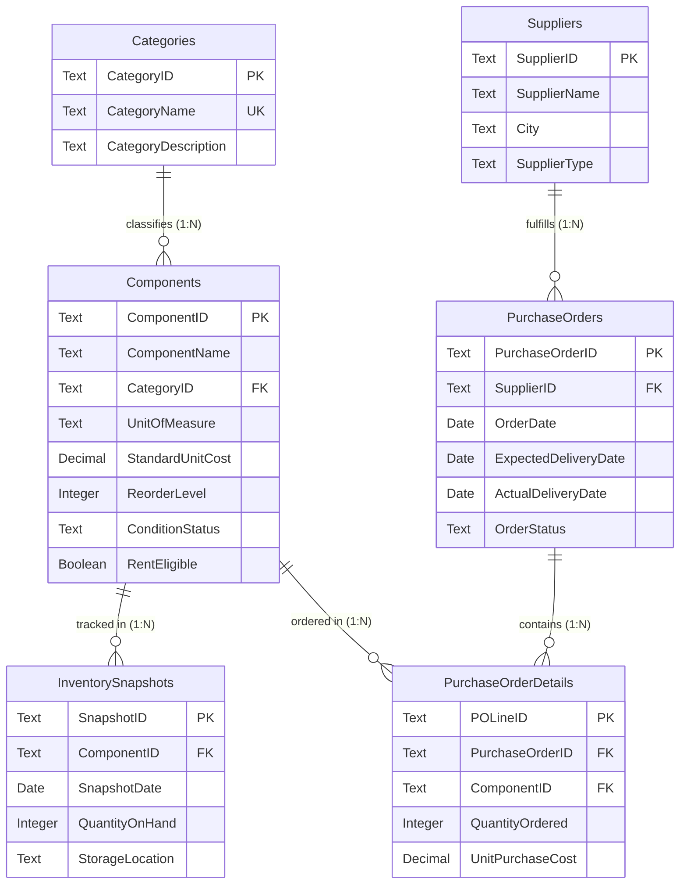

# Data Dictionary & Dataset Specification

## 1. Source Workbook Identity
- **Workbook File**: [`02_Dataset/raw/electronics_inventory_raw.xlsx`](raw/electronics_inventory_raw.xlsx)
- **Format**: Microsoft Excel OpenXML Spreadsheet (`.xlsx`)
- **Structure**: Six distinct relational worksheets acting as the source datasets for Power Query and Power BI.
- **Data Authenticity**: **100% Synthetic Data**. Fictional records created specifically for demonstration and simulation.
- **Reporting Currency**: Indian Rupee (**INR - ₹**).
- **Unit of Measurement**: **Piece** (standardized across all components).
- **Operational Horizon**: Calendar year **2025**.

---

## 2. Worksheet Sizing & Relationship Overview

| Worksheet | Purpose | Record Count | Key Identifier | Relationship Role |
| :--- | :--- | :---: | :---: | :--- |
| **`Categories`** | Component category master definitions | **8** | `CategoryID` | Dimension — Classifies `Components` (1:N) |
| **`Components`** | Master electronic component catalog | **105** | `ComponentID` | Conformed Dimension — Referenced by `InventorySnapshots` & `PurchaseOrderDetails` (1:N) |
| **`Suppliers`** | Vendor profiles across Indian industrial hubs | **50** | `SupplierID` | Dimension — Fulfills `PurchaseOrders` (1:N) |
| **`InventorySnapshots`** | Monthly stock observations (12 dates in 2025) | **1,260** | `SnapshotID` | Fact (Periodic Snapshot) — Monthly stock counts |
| **`PurchaseOrders`** | Purchase order headers and fulfillment dates | **100** | `PurchaseOrderID` | Fact Header / Bridge — Header for line items |
| **`PurchaseOrderDetails`**| Detailed component-level purchase line items | **125** | `POLineID` | Fact (Transactional) — Ordered quantities & costs |

---

## 3. Power BI Entity-Relationship Diagram

---

## 4. Detailed Worksheet Column Specifications

### Worksheet 1: `Categories`
**Purpose**: Stores the master categories of electronic components.

| Column | Data Type | Key Role | Business Description | Example / Allowed Values |
| :--- | :--- | :---: | :--- | :--- |
| `CategoryID` | Text | **Primary Key** | Unique 6-character identifier for the category | `CAT001`, `CAT002`, ... `CAT008` |
| `CategoryName` | Text | **Unique** | Descriptive name of the component category | `Passive Components`, `Sensors` |
| `CategoryDescription` | Text | — | Functional summary of parts contained within the category | `Non-amplifying electronic components including fixed/variable resistors...` |

#### Category Master Catalog (8 Records):
1. `CAT001` — **Passive Components** (Resistors, capacitors, power inductors)
2. `CAT002` — **Diodes and LEDs** (Rectifier diodes, Zener diodes, switching diodes, indicator LEDs)
3. `CAT003` — **Transistors and MOSFETs** (BJTs, N-channel MOSFETs, P-channel MOSFETs, Darlington pairs)
4. `CAT004` — **Integrated Circuits** (Operational amplifiers, timers, voltage regulators, logic ICs)
5. `CAT005` — **Sensors** (Temperature, humidity, ultrasonic, PIR, gas, and light sensors)
6. `CAT006` — **Microcontrollers and Development Boards** (8-bit/32-bit MCUs, dev boards, breakout modules)
7. `CAT007` — **Connectors and Cables** (Terminal blocks, pin headers, USB receptacles, jumper wires)
8. `CAT008` — **Electromechanical Components** (Relays, push switches, rocker switches, cooling fans)

---

### Worksheet 2: `Components`
**Purpose**: Stores the master catalog information for individual electronic components.

| Column | Data Type | Key Role | Business Description | Example / Allowed Values |
| :--- | :--- | :---: | :--- | :--- |
| `ComponentID` | Text | **Primary Key** | Unique 6-character component identifier | `CMP001` through `CMP105` |
| `ComponentName` | Text | — | Detailed technical name and specification of the part | `10k Ohm 1/4W Metal Film Resistor 1%` |
| `CategoryID` | Text | **Foreign Key** | Connects to `Categories[CategoryID]` | `CAT001` through `CAT008` |
| `UnitOfMeasure` | Text | — | Standard unit of count; standardized across all items | `Piece` |
| `StandardUnitCost` | Decimal (2 dec) | — | Benchmark reference cost in INR (₹) used for inventory holding valuation | `0.50`, `12.00`, `380.00` |
| `ReorderLevel` | Integer | — | Safety stock threshold triggering replenishment alerts | `10` to `600` |
| `ConditionStatus` | Text | — | Recorded physical condition of component stock | `New`, `Refurbished` |
| `RentEligible` | Boolean | — | Boolean flag indicating eligibility for rental programs | `TRUE`, `FALSE` |

> [!NOTE]
> - **Valuation Role**: `StandardUnitCost` is the constant baseline reference cost used for inventory valuation. It is tracked separately from historical procurement costs recorded in `PurchaseOrderDetails`.
> - **Reorder Threshold**: `ReorderLevel` is used to classify stock health into Healthy, Low Stock, or Zero Stock.
> - **Rental Indicator**: `RentEligible` indicates whether a component model is eligible for rental programs; it does not indicate whether an item is currently on rent.

---

### Worksheet 3: `Suppliers`
**Purpose**: Stores supplier and vendor profile information.

| Column | Data Type | Key Role | Business Description | Example / Allowed Values |
| :--- | :--- | :---: | :--- | :--- |
| `SupplierID` | Text | **Primary Key** | Unique 6-character supplier identifier | `SUP001` through `SUP050` |
| `SupplierName` | Text | — | Commercial name of the vendor/supplier | `ElectroVibe Components Pvt Ltd` |
| `City` | Text | — | Indian industrial hub / supplier headquarters | `Bengaluru`, `Hyderabad`, `Pune`, `Chennai`, `Noida` |
| `SupplierType` | Text | — | Business classification of the vendor | `Authorized Distributor`, `Direct OEM`, `Wholesale Importer`, `Independent Stockist`, `Turnkey Component Supplier` |

---

### Worksheet 4: `InventorySnapshots`
**Purpose**: Stores recorded physical stock counts of each component at monthly intervals.

| Column | Data Type | Key Role | Business Description | Example / Allowed Values |
| :--- | :--- | :---: | :--- | :--- |
| `SnapshotID` | Text | **Primary Key** | Unique identifier for the monthly snapshot record | `INV0001` through `INV1260` |
| `ComponentID` | Text | **Foreign Key** | References `Components[ComponentID]` | `CMP001` through `CMP105` |
| `SnapshotDate` | Date | — | End-of-month observation date (ISO `yyyy-MM-dd`) | `2025-01-31`, `2025-02-28`, ... `2025-12-31` |
| `QuantityOnHand` | Integer | — | Physical stock counted on hand on the snapshot date | `0` to `2,500` pieces |
| `StorageLocation` | Text | — | Assigned warehouse aisle, bin, or secure cabinet | `Aisle-A-Bin01`, `Cabinet-F-Sec01` |

> [!IMPORTANT]
> - **Periodic Snapshot Nature**: Each record represents a stock observation at a specific point in time. This is **not** a transaction-level stock movement ledger (it does not record individual receipts, issues, or scrap events).
> - **Aggregation Rule**: For current inventory KPIs, calculations must evaluate a specific selected snapshot date. **Do not sum all 12 monthly snapshots**, as doing so would multiply inventory counts across months.

---

### Worksheet 5: `PurchaseOrders`
**Purpose**: Stores purchase order header information, milestone dates, and fulfillment statuses.

| Column | Data Type | Key Role | Business Description | Example / Allowed Values |
| :--- | :--- | :---: | :--- | :--- |
| `PurchaseOrderID` | Text | **Primary Key** | Unique purchase order header identifier | `PO001` through `PO100` |
| `SupplierID` | Text | **Foreign Key** | References `Suppliers[SupplierID]` | `SUP001` through `SUP050` |
| `OrderDate` | Date | — | Date the purchase order was issued | `2025-01-05` to `2025-12-20` |
| `ExpectedDeliveryDate`| Date | — | Committed delivery date by the vendor | `2025-01-18` (typically 7–18 days lead time) |
| `ActualDeliveryDate` | Date | Nullable | Date goods were physically received (*null if unfulfilled*) | `2025-01-13` (*blank for Pending/Cancelled*) |
| `OrderStatus` | Text | — | Current fulfillment status | `Delivered` (80), `Pending` (12), `Cancelled` (8) |

#### Order Status Rules:
- **`Delivered` (80 orders)**: Completed deliveries. `ActualDeliveryDate` is always populated. Used to calculate Average Delivery Lead Time and On-Time Delivery Rate (OTD %).
- **`Pending` (12 orders)**: Active unfulfilled orders placed in Q4 2025. `ActualDeliveryDate` is empty (`null`). Included in Total Procurement Spend calculation.
- **`Cancelled` (8 orders)**: Voided purchase orders. `ActualDeliveryDate` is empty (`null`). Excluded from Net Procurement Spend and lead-time metrics.

---

### Worksheet 6: `PurchaseOrderDetails`
**Purpose**: Stores component line items included in each purchase order.

| Column | Data Type | Key Role | Business Description | Example / Allowed Values |
| :--- | :--- | :---: | :--- | :--- |
| `POLineID` | Text | **Primary Key** | Unique purchase order line item identifier | `POL0001` through `POL0125` |
| `PurchaseOrderID` | Text | **Foreign Key** | References `PurchaseOrders[PurchaseOrderID]` | `PO001` through `PO100` |
| `ComponentID` | Text | **Foreign Key** | References `Components[ComponentID]` | `CMP001` through `CMP105` |
| `QuantityOrdered` | Integer | — | Quantity of pieces ordered on this line item | `10` to `2,000` pieces |
| `UnitPurchaseCost` | Decimal (2 dec) | — | Actual negotiated unit purchase price in Rupee (₹) | `₹ 0.76`, `₹ 15.45`, `₹ 570.00` |

> [!NOTE]
> - **Header vs Line Relationship**: A single purchase order header in `PurchaseOrders` can contain multiple component lines in `PurchaseOrderDetails`.
> - **Actual vs Standard Cost**: `UnitPurchaseCost` records the actual price negotiated on that purchase order. This varies from `StandardUnitCost` due to volume discounts or spot market pricing.

---

## 5. Model Multiplicity & Filter Direction

| Parent Dataset (1) | Child Dataset (N) | Foreign Key Column | Active In Power BI | Filter Direction |
| :--- | :--- | :--- | :---: | :---: |
| `Categories` | `Components` | `CategoryID` | Yes | Single (`Categories` $\rightarrow$ `Components`) |
| `Components` | `InventorySnapshots` | `ComponentID` | Yes | Single (`Components` $\rightarrow$ `InventorySnapshots`) |
| `Components` | `PurchaseOrderDetails` | `ComponentID` | Yes | Single (`Components` $\rightarrow$ `PurchaseOrderDetails`) |
| `Suppliers` | `PurchaseOrders` | `SupplierID` | Yes | Single (`Suppliers` $\rightarrow$ `PurchaseOrders`) |
| `PurchaseOrders` | `PurchaseOrderDetails` | `PurchaseOrderID` | Yes | Single (`PurchaseOrders` $\rightarrow$ `PurchaseOrderDetails`) |
