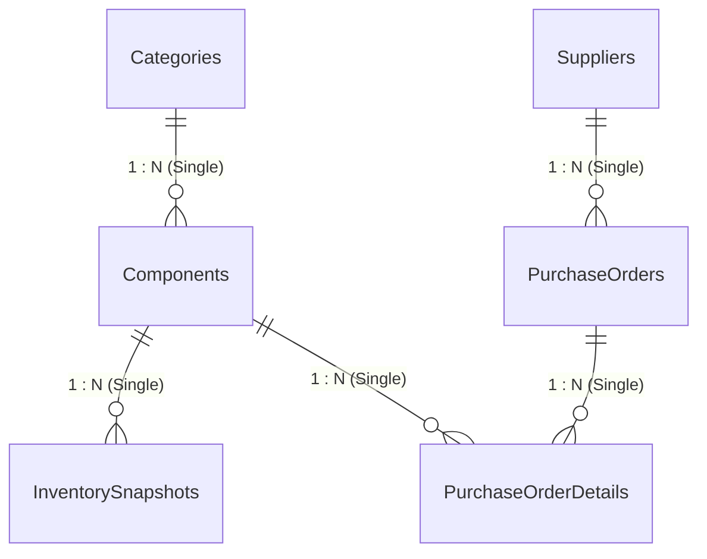

# Power BI Data Model Documentation

## 1. Overview & Architecture
This document specifies the relational data model constructed within **Microsoft Power BI Desktop** for the **Electronics Component Inventory & Procurement Analytics** dashboard.

The architecture employs dimensional modeling best practices—structuring tables into dimensions and fact tables to maximize VertiPaq memory compression and support intuitive, performant DAX evaluations.



---

## 2. Table Classifications & Roles

| Table Name | Classification | Primary Key | Foreign Keys | Role in Model |
| :--- | :--- | :--- | :--- | :--- |
| **`Categories`** | Dimension | `CategoryID` | — | Component category attributes (`CategoryName`, `CategoryDescription`) |
| **`Components`** | Conformed Dimension | `ComponentID` | `CategoryID` | Master component attributes, reorder levels, conditions, and standard costs (₹) |
| **`Suppliers`** | Dimension | `SupplierID` | — | Vendor profiles, classifications, and geographic cities |
| **`InventorySnapshots`** | Fact (Periodic Snapshot) | `SnapshotID` | `ComponentID` | Monthly recorded physical stock quantities across 12 observation dates |
| **`PurchaseOrders`** | Fact Header / Bridge | `PurchaseOrderID` | `SupplierID` | Order-level header information, fulfillment dates, and order statuses |
| **`PurchaseOrderDetails`**| Fact (Transactional) | `POLineID` | `PurchaseOrderID`, `ComponentID` | Line-item ordered quantities and actual negotiated unit purchase prices (₹) |
| **`Date`** *(Analytical)* | Dedicated Dimension | `Date` | — | DAX-generated calendar table supporting time intelligence and trend slicing |

---

## 3. Relationships & Filter Propagation

The data model features five core physical relationships connecting the six imported Excel tables:

| One-Side Table (1) | Many-Side Table (N) | Join Key Column | Cardinality | Filter Direction | Active State |
| :--- | :--- | :--- | :---: | :---: | :---: |
| `Categories` | `Components` | `CategoryID` | $1 : N$ | Single (`Categories` filters `Components`) | Active |
| `Components` | `InventorySnapshots` | `ComponentID` | $1 : N$ | Single (`Components` filters `Snapshots`) | Active |
| `Components` | `PurchaseOrderDetails` | `ComponentID` | $1 : N$ | Single (`Components` filters `Details`) | Active |
| `Suppliers` | `PurchaseOrders` | `SupplierID` | $1 : N$ | Single (`Suppliers` filters `PurchaseOrders`) | Active |
| `PurchaseOrders` | `PurchaseOrderDetails` | `PurchaseOrderID` | $1 : N$ | Single (`PurchaseOrders` filters `Details`) | Active |

### Design Considerations:
- **Strict Single-Direction Filtering**: Filter context flows strictly from Dimension tables to Fact tables ($1 \rightarrow N$). Bidirectional filtering is deliberately avoided to eliminate ambiguous filter paths and ensure deterministic DAX calculation results.
- **Conformed Component Dimension**: `Components` connects directly to both the Inventory fact (`InventorySnapshots`) and the Procurement fact (`PurchaseOrderDetails`), enabling seamless cross-domain analysis.
- **Hidden Keys**: Primary and foreign key columns on fact tables are marked as hidden in Report View to guide report authors to use Dimension fields for slicing and grouping.

---

## 4. Analytical Date Dimension (DAX Calendar)

To support time intelligence, date slicers, and month-over-month trend visuals, a dedicated analytical **Date Table** is created inside Power BI using DAX:

```dax
Date = 
VAR MinDate = DATE( 2025, 1, 1 )
VAR MaxDate = DATE( 2025, 12, 31 )
RETURN
    ADDCOLUMNS(
        CALENDAR( MinDate, MaxDate ),
        "Year", YEAR( [Date] ),
        "Month Number", MONTH( [Date] ),
        "Month Name", FORMAT( [Date], "MMMM" ),
        "Month-Year", FORMAT( [Date], "MMM yyyy" ),
        "Quarter", "Q" & FORMAT( [Date], "Q" ),
        "Year-Quarter", FORMAT( [Date], "yyyy" ) & "-Q" & FORMAT( [Date], "Q" )
    )
```

### Multiple Date Role Handling:
The model contains multiple date fields across tables:
- `InventorySnapshots[SnapshotDate]`
- `PurchaseOrders[OrderDate]`
- `PurchaseOrders[ExpectedDeliveryDate]`
- `PurchaseOrders[ActualDeliveryDate]`

**Best-Practice Implementation**:
- The active relationship from `Date[Date]` connects to `PurchaseOrders[OrderDate]` to govern general procurement timeline slicing.
- Inactive relationships are established to `PurchaseOrders[ExpectedDeliveryDate]` and `PurchaseOrders[ActualDeliveryDate]`, activated via `USERELATIONSHIP()` when evaluating delivery deadlines.
- A dedicated active relationship connects `Date[Date]` to `InventorySnapshots[SnapshotDate]` for monthly inventory slicing.

---

## 5. Domain-Specific Calculation Considerations

### A. Inventory Calculation Rules
- **Snapshot Selection Context**: Because `InventorySnapshots` holds periodic monthly observations, aggregating `QuantityOnHand` across all dates without a date filter multiplies inventory counts. All current inventory measures must evaluate within a specific selected snapshot context.
- **Valuation Reference**: Inventory valuation must always reference `Components[StandardUnitCost]`, which represents the standard benchmark cost, using `RELATED(Components[StandardUnitCost])`.

### B. Procurement Calculation Rules
- **Header vs Line Item Granularity**: Order status (`Delivered`, `Pending`, `Cancelled`) resides on `PurchaseOrders`, while quantities and prices reside on `PurchaseOrderDetails`. Total procurement spend must aggregate line items while evaluating header status.
- **Cancelled Order Handling**: Cancelled purchase orders must be explicitly excluded from procurement spend measures, while pending orders must remain included because they represent active uncancelled commitments.
- **Delivery Lead Time Restriction**: Lead time calculations (`ActualDeliveryDate - OrderDate`) must strictly filter for `OrderStatus = "Delivered"` and exclude rows with blank actual delivery dates.
