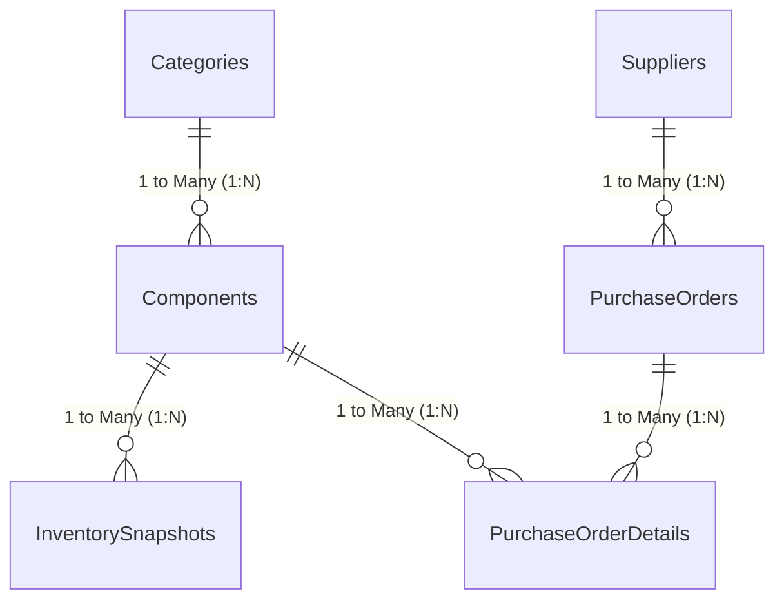

# Data Model Documentation

## Overview
This document specifies the relational data model for the **Electronics Component Inventory and Procurement Analysis Dashboard** in Microsoft Power BI.

The model is designed using Power BI star/snowflake schema best practices to support both **Inventory Analytics** and **Procurement Analytics** with maximum VertiPaq compression performance and intuitive DAX modeling.

---

## Schema Architecture

### Table Classifications

| Table Name | Classification | Primary Key | Foreign Keys | Role / Description |
| :--- | :--- | :--- | :--- | :--- |
| `Categories` | Dimension | `CategoryID` | — | Component category master |
| `Components` | Dimension / Conformed | `ComponentID` | `CategoryID` | Master electronic parts catalog |
| `Suppliers` | Dimension | `SupplierID` | — | Vendor profiles and geographic distribution |
| `InventorySnapshots` | Fact (Periodic Snapshot) | `SnapshotID` | `ComponentID` | Monthly inventory quantities on hand |
| `PurchaseOrders` | Fact Header / Bridge | `PurchaseOrderID` | `SupplierID` | Order header dates, status, and fulfillment |
| `PurchaseOrderDetails` | Fact (Transactional) | `POLineID` | `PurchaseOrderID`, `ComponentID` | Line-item quantities ordered and purchase prices (₹) |

---

## Relationships & Cardinality

| From Table (Many) | To Table (One) | Active Key Relationship | Cardinality | Cross Filter Direction |
| :--- | :--- | :--- | :---: | :---: |
| `Components` | `Categories` | `CategoryID` → `CategoryID` | N : 1 | Single (`Categories` filters `Components`) |
| `InventorySnapshots` | `Components` | `ComponentID` → `ComponentID` | N : 1 | Single (`Components` filters `InventorySnapshots`) |
| `PurchaseOrders` | `Suppliers` | `SupplierID` → `SupplierID` | N : 1 | Single (`Suppliers` filters `PurchaseOrders`) |
| `PurchaseOrderDetails` | `PurchaseOrders` | `PurchaseOrderID` → `PurchaseOrderID` | N : 1 | Single (`PurchaseOrders` filters `Details`) |
| `PurchaseOrderDetails` | `Components` | `ComponentID` → `ComponentID` | N : 1 | Single (`Components` filters `Details`) |

---

## Star Schema Integrity Rules

1. **Single-Direction Filter Propagation**:
   - Filter propagation strictly flows from dimension tables down to fact tables (`1 → Many`).
   - Bidirectional filtering is avoided to maintain deterministic query evaluation and avoid relationship ambiguity.

2. **Foreign Key Visibility**:
   - Foreign key columns in fact tables (`ComponentID`, `PurchaseOrderID`, `SupplierID`) are hidden in the Power BI Report view to prevent users from accidentally aggregating key columns.

3. **Conformed Dimension**:
   - The `Components` dimension acts as a conformed dimension connecting both the **Inventory Analytics** star and the **Procurement Analytics** star, enabling cross-domain analysis such as comparing current stock on hand against pending purchase orders.
