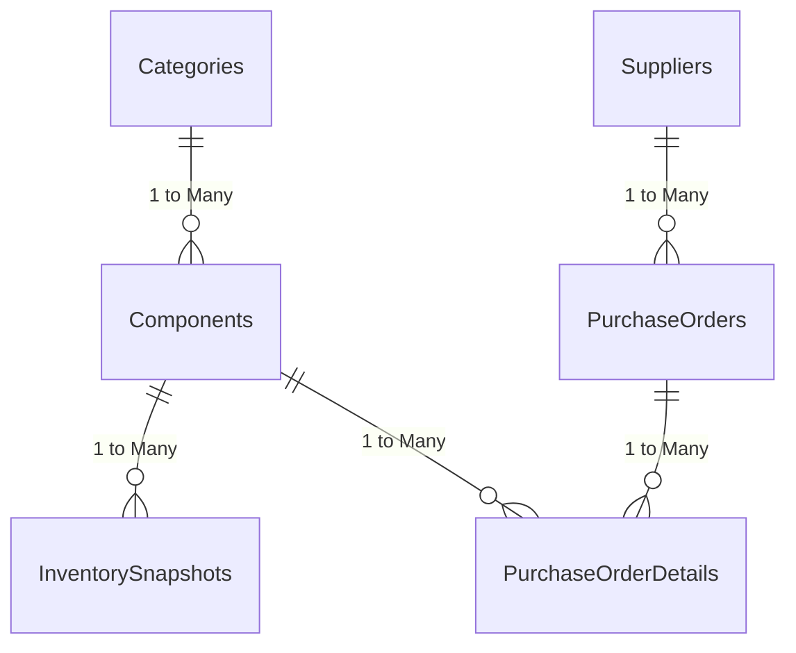

# Data Model Documentation

## Overview
This document specifies the relational data model for the **Electronics Component Inventory and Procurement Analysis Dashboard**.

The model is designed using Power BI star/snowflake schema best practices to support both **Inventory Analytics** and **Procurement Analytics** with maximum query performance and intuitive DAX modeling.

---

## Schema Architecture

### Table Classifications

| Table Name | Classification | Primary Key | Foreign Keys | Role |
| :--- | :--- | :--- | :--- | :--- |
| `Categories` | Dimension | `CategoryID` | — | Component category master |
| `Components` | Dimension / Conformed | `ComponentID` | `CategoryID` | Master component catalog |
| `Suppliers` | Dimension | `SupplierID` | — | Vendor profiles |
| `InventorySnapshots` | Fact (Periodic Snapshot) | `SnapshotID` | `ComponentID` | Monthly inventory quantities on hand |
| `PurchaseOrders` | Fact Header / Dimension Bridge | `PurchaseOrderID` | `SupplierID` | Order header, dates, and fulfillment status |
| `PurchaseOrderDetails` | Fact (Transactional) | `POLineID` | `PurchaseOrderID`, `ComponentID` | Line-item ordered quantities and purchase costs |

---

## Relationships & Cardinality

| From Table (Many) | To Table (One) | Active Key Relationship | Cardinality | Cross Filter Direction |
| :--- | :--- | :--- | :---: | :---: |
| `Components` | `Categories` | `CategoryID` → `CategoryID` | N : 1 | Single (Categories filters Components) |
| `InventorySnapshots` | `Components` | `ComponentID` → `ComponentID` | N : 1 | Single (Components filters InventorySnapshots) |
| `PurchaseOrders` | `Suppliers` | `SupplierID` → `SupplierID` | N : 1 | Single (Suppliers filters PurchaseOrders) |
| `PurchaseOrderDetails` | `PurchaseOrders` | `PurchaseOrderID` → `PurchaseOrderID` | N : 1 | Single (PurchaseOrders filters Details) |
| `PurchaseOrderDetails` | `Components` | `ComponentID` → `ComponentID` | N : 1 | Single (Components filters Details) |

---

## Core Analytical Measures & Calculations

1. **Current / Snapshot Inventory Valuation**:
   $$\text{Inventory Valuation} = \sum (\text{QuantityOnHand} \times \text{StandardUnitCost})$$

2. **Stock Condition Classifications**:
   - **Zero Stock**: $\text{QuantityOnHand} = 0$
   - **Low Stock**: $\text{QuantityOnHand} > 0 \text{ and } \text{QuantityOnHand} < \text{ReorderLevel}$
   - **Healthy Stock**: $\text{QuantityOnHand} \ge \text{ReorderLevel}$

3. **Total PO Committed Spend**:
   $$\text{Total PO Spend} = \sum (\text{QuantityOrdered} \times \text{UnitPurchaseCost}) \quad [\text{for non-cancelled orders}]$$

4. **Delivery Lead Time (Days)**:
   $$\text{Lead Time} = \text{DATEDIFF}(\text{OrderDate}, \text{ActualDeliveryDate}, \text{DAY}) \quad [\text{for Delivered orders}]$$

5. **On-Time Delivery Rate (OTD %)**:
   $$\text{OTD \%} = \frac{\text{Count of Orders where } \text{ActualDeliveryDate} \le \text{ExpectedDeliveryDate}}{\text{Total Delivered Orders}} \times 100$$
