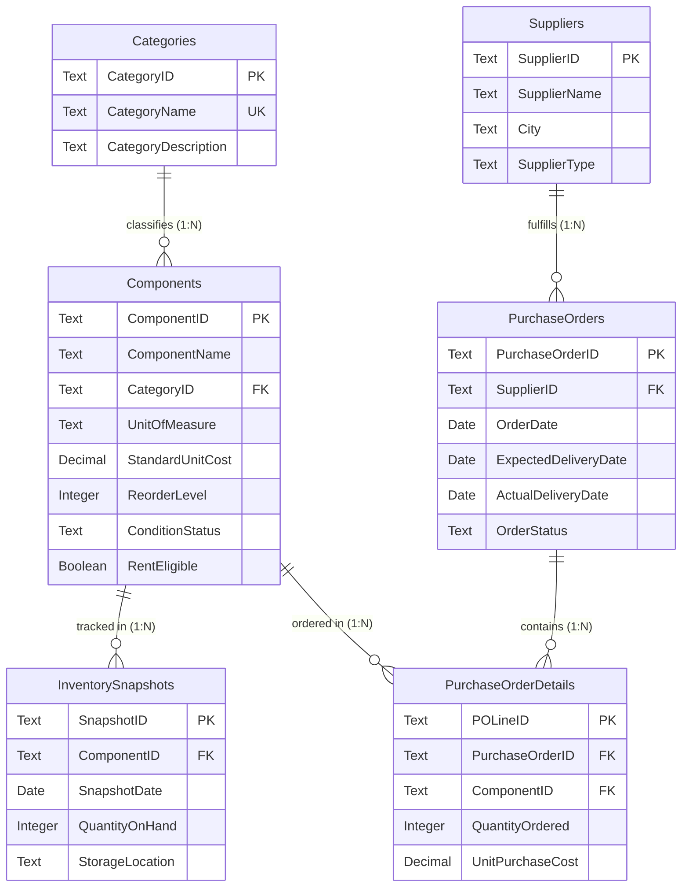
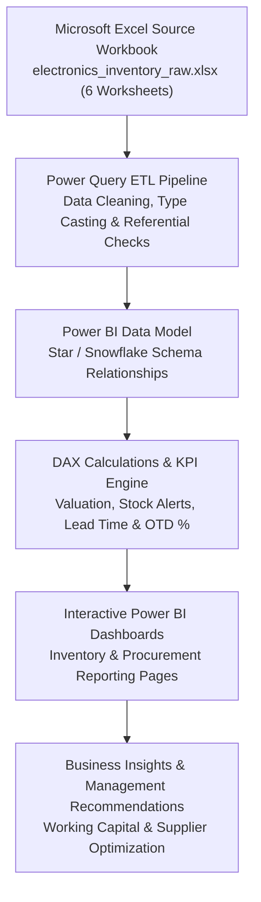

# Electronics Component Inventory & Procurement Analytics

[](02_Dataset/raw/electronics_inventory_raw.xlsx)
[](03_Power_Query/transformation_documentation.md)
[](04_Power_BI/)
[](04_Power_BI/dax_measures.md)
[-success.svg)](02_Dataset/)
[](LICENSE)

An end-to-end Data Analytics and Business Intelligence project focused on component inventory management, stock health, and procurement analytics within the electronics industry.

---

## 1. Project Title
**Electronics Component Inventory & Procurement Analytics**

---

## 2. Project Overview
This project simulates the operational environment of a fictional electronics component distributor and small-scale electronics manufacturing business. The enterprise manages an extensive catalog of electronic components—ranging from basic passive devices (resistors, capacitors) to discrete semiconductors, integrated circuits, environmental sensors, microcontrollers, and interconnects.

The solution consolidates disconnected operational spreadsheets from **Microsoft Excel**, cleanses and transforms the data using **Power Query**, constructs a star/snowflake dimensional model in **Microsoft Power BI Desktop**, evaluates operational KPIs using **DAX**, and presents executive decision-support insights through interactive dashboard pages.

---

## 3. Executive Summary

| Project Dimension | Specification |
| :--- | :--- |
| **Project Type** | End-to-end Data Analytics & Business Intelligence Solution |
| **Industry Scenario** | Fictional Electronics Component Distributor & Small Manufacturing Enterprise |
| **Primary Users** | **Inventory Managers** & **Procurement Managers** |
| **Reporting Currency**| Indian Rupee (**INR - ₹**) |
| **Unit of Measurement**| **Piece** (standardized across all component categories) |
| **Data Authenticity** | **100% Synthetic Data** (Relational dataset created from scratch for simulation) |
| **Operational Period** | Calendar Year **2025** |
| **Core Architecture** | Microsoft Excel $\rightarrow$ Power Query $\rightarrow$ Power BI Data Model $\rightarrow$ DAX Measures $\rightarrow$ Dashboards |

---

## 4. Business Scenario
Consider an electronics manufacturing and distribution business managing thousands of electronic parts used across printed circuit board (PCB) assemblies, finished electronic products, and control boards.

For example, when producing an electronic control unit, the assembly line requires synchronized availability of:
- Microcontrollers & evaluation kits
- Precision resistors & low-ESR capacitors
- Sensing modules (temperature, ultrasonic, motion)
- Linear voltage regulators & operational amplifiers
- Interconnect headers, terminal blocks, and relays

To avoid production stoppages, the company must maintain adequate stock buffers. Simultaneously, it purchases replenishment parts from diverse commercial suppliers across India, with varying unit pricing and delivery lead times. The business requires operational visibility into two core domains:
1. **Inventory Management**: Stock availability, reorder alerts, stockout mitigation, and capital holding valuation.
2. **Procurement Management**: Purchase order tracking, spend concentration, delivery turnaround times, and vendor reliability.

---

## 5. Problem Statement

When operational data is maintained in isolated, manual spreadsheets across separate departments:

### Inventory-Related Challenges
- **Low-Stock Visibility**: Identifying parts that fall below safety reorder thresholds requires manual comparison across 105 part numbers.
- **Stockout Risks**: Components that run out of stock (`QuantityOnHand = 0`) are caught reactively after assembly lines halt.
- **Inaccurate Valuation**: Calculating the monetary carrying value of physical inventory across changing stock levels is slow and prone to errors.
- **Category Imbalance**: Managers cannot easily see whether capital is trapped in slow-moving microcontrollers or distributed effectively.
- **Monthly Trajectory Gaps**: Understanding inventory progression across periodic monthly snapshots requires tedious manual compilation.
- **Obscured Rental Assets**: Prototyping development platforms eligible for commercial rental cannot be readily identified.

### Procurement-Related Challenges
- **Scattered Purchase Orders**: Total purchasing commitments and order pipelines are difficult to track.
- **Unclear Procurement Spend**: Summing purchase order commitment values while excluding cancelled orders is cumbersome.
- **Vendor Concentration Risks**: Management lacks visibility into which suppliers receive the highest purchasing budget.
- **Order Frequency vs Volume**: The business struggles to distinguish frequently reordered parts from bulk purchases.
- **Delivery Lead-Time Delays**: Turnaround times between order placement and receipt date are not systematically monitored.
- **Unmeasured Delivery Reliability**: Supplier On-Time Delivery rates (OTD %) are untracked.
- **Purchase Price Variance**: The business cannot compare pricing across different vendors for identical components.

---

## 6. Proposed Solution
The project delivers an interactive Power BI solution that integrates operational records from a structured Excel workbook:
1. **Source Data Management (Excel)**: Six normalized worksheets modeling categories, components, suppliers, monthly inventory snapshots, purchase orders, and line items.
2. **Automated ETL (Power Query)**: Ingests, normalizes, casts explicit data types, and validates referential keys.
3. **Dimensional Modelling (Power BI)**: Establishes a star/snowflake schema with single-direction filter propagation.
4. **Analytical Calculation Engine (DAX)**: Calculates inventory valuation, stockout alerts, lead times, and on-time fulfillment rates.
5. **Interactive Executive Dashboards**: Visualizes KPIs through multi-page dashboards equipped with slicers, cross-filtering, and drill-downs.

---

## 7. Project Objectives
1. Eliminate manual spreadsheet analysis through an automated BI reporting pipeline.
2. Enable proactive inventory control with instant low-stock and zero-stock alerts.
3. Deliver dynamic inventory holding valuation in Indian Rupee (INR - ₹).
4. Benchmark supplier delivery performance via lead time and On-Time Delivery % (OTD).
5. Expose purchase price variances across vendors to strengthen procurement negotiations.

---

## 8. Analytical Modules

### Module A: Inventory Analytics (For Inventory Managers)
- Component catalog breadth (105 distinct parts).
- Recorded stock quantity across components for selected snapshot dates.
- Category-wise stock volume distribution across 8 component categories.
- Early-warning low-stock alerts (`0 < QuantityOnHand < ReorderLevel`).
- Immediate zero-stock alerts (`QuantityOnHand = 0`).
- Inventory holding valuation based on standard unit cost in INR (₹).
- Capital allocation breakdown across categories.
- Monthly stock quantity trends across 12 snapshot periods in 2025.
- Tracking of rental-eligible components.

### Module B: Procurement Analytics (For Procurement Managers)
- Total purchase orders issued across 2025 (100 POs).
- Net committed procurement spend across non-cancelled purchase orders.
- Supplier spend concentration across 50 registered vendors.
- Frequently procured components and total pieces ordered.
- Monthly procurement expenditure trajectory.
- Order fulfillment status breakdown (Delivered: 80, Pending: 12, Cancelled: 8).
- Average delivery lead time in calendar days for fulfilled deliveries.
- Supplier On-Time Delivery Rate (OTD %).
- Purchase price variance analysis across suppliers for identical parts.

---

## 9. Business Requirements

The solution answers 18 specific business questions:

### Inventory Questions
1. **Total Components**: How many distinct electronic components are maintained in the component catalogue? *(105 components)*
2. **Total Stock Quantity**: What is the recorded stock quantity across the components for the selected inventory snapshot?
3. **Category-wise Stock Distribution**: Which electronic component categories contain the highest stock quantities?
4. **Low Stock Components**: Which components have a stock quantity below their respective reorder levels? (`QuantityOnHand > 0 && QuantityOnHand < ReorderLevel`)
5. **Zero Stock Components**: Which components have zero recorded stock? (`QuantityOnHand = 0`)
6. **Inventory Valuation**: What is the estimated monetary value of the inventory? (`QuantityOnHand × StandardUnitCost` in ₹)
7. **Category-wise Inventory Valuation**: Which component categories account for the highest inventory value?
8. **Monthly Stock Trend**: How do recorded stock quantities change across the monthly inventory snapshots?
9. **Rental Eligibility**: How many components are marked as eligible for rental programmes?

### Procurement Questions
1. **Total Purchase Orders**: How many purchase orders were issued during the operational year? *(100 POs)*
2. **Procurement Value**: What is the total value of non-cancelled purchase orders? (`QuantityOrdered × UnitPurchaseCost`)
3. **Supplier-wise Procurement Value**: Which suppliers account for the highest purchasing value?
4. **Frequently Procured Components**: Which electronic components appear most frequently in purchase order line items?
5. **Monthly Procurement Trend**: How does procurement value change across months?
6. **Purchase Order Status**: What proportion of purchase orders are Delivered (80%), Pending (12%), or Cancelled (8%)?
7. **Average Delivery Lead Time**: How many days does a supplier take to deliver an order? (`ActualDeliveryDate - OrderDate`)
8. **On-Time Delivery Rate**: What percentage of delivered orders arrived on or before their expected delivery date?
9. **Supplier Price Comparison**: How do suppliers differ in the purchase prices they offer for identical components?

---

## 10. Dataset Overview

- **Source File**: [`02_Dataset/raw/electronics_inventory_raw.xlsx`](02_Dataset/raw/electronics_inventory_raw.xlsx)
- **Data Authenticity**: **100% Synthetic Data**.
- **Reporting Currency**: Indian Rupee (**INR - ₹**).
- **Unit of Measurement**: **Piece** (standardized across all items).
- **Operational Horizon**: Calendar year **2025**.

---

## 11. Excel Workbook Structure

The source workbook contains six relational worksheets:

| Worksheet | Contents | Row Count | Primary Key | Key Relationships |
| :--- | :--- | :---: | :---: | :--- |
| **`Categories`** | Component category master catalog | **8** | `CategoryID` | Classifies `Components` (1:N) |
| **`Components`** | Master electronic component catalog | **105** | `ComponentID` | Referenced by `Snapshots` & `Details` (1:N) |
| **`Suppliers`** | Vendor profiles across Indian industrial hubs | **50** | `SupplierID` | Fulfills `PurchaseOrders` (1:N) |
| **`InventorySnapshots`** | Monthly stock observations (12 dates in 2025) | **1,260** | `SnapshotID` | Tracks `Components` across time |
| **`PurchaseOrders`** | Purchase order headers and fulfillment dates | **100** | `PurchaseOrderID` | Header for `PurchaseOrderDetails` (1:N) |
| **`PurchaseOrderDetails`**| Component line items per purchase order | **125** | `POLineID` | Detailed ordered quantities & prices |

---

## 12. Data Dictionary Summary



Detailed column specifications and value constraints are documented in [**`02_Dataset/data_dictionary.md`**](02_Dataset/data_dictionary.md).

---

## 13. Power Query ETL Workflow

Power Query extracts the six worksheets, enforces data quality rules, and prepares the datasets for Power BI:
- **Header Promotion**: Promoted first row of each worksheet to column headers.
- **Text Normalization**: Trimmed whitespace and standardized case formatting across names and descriptions.
- **Explicit Data Typing**: Explicitly cast text, whole number, decimal number, date, and boolean types.
- **Controlled Null Handling**: Preserved `null` values for `ActualDeliveryDate` in `Pending` and `Cancelled` orders without injecting false dates or zeros.
- **Referential Integrity**: Validated foreign key mappings between parent dimensions and child facts.

Detailed ETL documentation is available in [**`03_Power_Query/transformation_documentation.md`**](03_Power_Query/transformation_documentation.md).

---

## 14. Power BI Data Model

The Power BI data model establishes a star/snowflake schema with single-direction 1-to-many relationships:
- `Categories[CategoryID]` (1) $\rightarrow$ `Components[CategoryID]` (N)
- `Components[ComponentID]` (1) $\rightarrow$ `InventorySnapshots[ComponentID]` (N)
- `Components[ComponentID]` (1) $\rightarrow$ `PurchaseOrderDetails[ComponentID]` (N)
- `Suppliers[SupplierID]` (1) $\rightarrow$ `PurchaseOrders[SupplierID]` (N)
- `PurchaseOrders[PurchaseOrderID]` (1) $\rightarrow$ `PurchaseOrderDetails[PurchaseOrderID]` (N)
- **Analytical Date Table**: A dedicated DAX `Date` table provides time-intelligence slicing across 2025.

Detailed data modeling documentation is available in [**`04_Power_BI/data_model_documentation.md`**](04_Power_BI/data_model_documentation.md).

---

## 15. DAX and KPI Calculations

Core measures implemented in Power BI:

```dax
// 1. Total Inventory Valuation (₹)
Inventory Valuation = 
SUMX(
    InventorySnapshots,
    InventorySnapshots[QuantityOnHand] * RELATED( Components[StandardUnitCost] )
)

// 2. Zero Stock Alert
Zero Stock Components = 
CALCULATE(
    DISTINCTCOUNT( InventorySnapshots[ComponentID] ),
    InventorySnapshots[QuantityOnHand] = 0
)

// 3. Low Stock Alert (< Reorder Level)
Low Stock Components = 
CALCULATE(
    DISTINCTCOUNT( InventorySnapshots[ComponentID] ),
    FILTER(
        InventorySnapshots,
        InventorySnapshots[QuantityOnHand] > 0 &&
        InventorySnapshots[QuantityOnHand] < RELATED( Components[ReorderLevel] )
    )
)

// 4. Net Committed Procurement Spend (₹)
Total Procurement Spend = 
CALCULATE(
    SUMX(
        PurchaseOrderDetails,
        PurchaseOrderDetails[QuantityOrdered] * PurchaseOrderDetails[UnitPurchaseCost]
    ),
    PurchaseOrders[OrderStatus] <> "Cancelled"
)

// 5. Average Delivery Lead Time (Days)
Average Delivery Lead Time (Days) = 
CALCULATE(
    AVERAGEX(
        PurchaseOrders,
        DATEDIFF( PurchaseOrders[OrderDate], PurchaseOrders[ActualDeliveryDate], DAY )
    ),
    PurchaseOrders[OrderStatus] = "Delivered" &&
    NOT ISBLANK( PurchaseOrders[ActualDeliveryDate] )
)

// 6. Supplier On-Time Delivery Rate (OTD %)
On-Time Delivery Rate (OTD %) = 
DIVIDE(
    CALCULATE( COUNTROWS( PurchaseOrders ), PurchaseOrders[OrderStatus] = "Delivered" && PurchaseOrders[ActualDeliveryDate] <= PurchaseOrders[ExpectedDeliveryDate] ),
    CALCULATE( COUNTROWS( PurchaseOrders ), PurchaseOrders[OrderStatus] = "Delivered" ),
    0
)
```

Complete DAX formulas and business logic are documented in [**`04_Power_BI/dax_measures.md`**](04_Power_BI/dax_measures.md).

---

## 16. Dashboard Overview

The interactive Power BI report (`04_Power_BI/Electronics_Inventory_Procurement.pbix`) features two dedicated analytical pages:

### Page 1: Inventory Analytics Dashboard
- **Headline KPI Cards**: Total Inventory Value (₹), Total Stock Pieces, Low Stock Parts, Zero Stock Parts, Rental Fleet Count.
- **Stock Distribution by Category**: Clustered bar visual comparing pieces on hand vs holding valuation across all 8 component categories.
- **Monthly Stock Trajectory**: Area line visual displaying inventory holding trends across the 12 monthly snapshot dates.
- **Critical Reorder Matrix**: Detailed table displaying parts below reorder levels, warehouse bin locations, condition status, and reorder deficits.

### Page 2: Procurement & Supplier Analytics Dashboard
- **Headline KPI Cards**: Total Procurement Spend (₹), Total POs, Delivered Orders, Average Lead Time (11.4 Days), On-Time Delivery Rate (76.25%).
- **Monthly Procurement Spend**: Column chart tracking purchasing expenditure over the operational year.
- **Supplier Performance Matrix**: Scatter plot correlating Supplier Spend vs Delivery Lead Time and OTD %.
- **Order Pipeline Status**: Donut chart displaying Delivered (80%), Pending (12%), and Cancelled (8%) orders.
- **Supplier Price Variance Table**: Comparison of actual unit purchase costs vs benchmark catalog standard costs.

---

## 17. End-to-End Project Architecture



---

## 18. Repository Structure

```text
Electronics-Component-Analytics/
│
├── README.md                            # Master project documentation
├── PROJECT_CONTEXT.md                   # Developer & AI operational context
├── .gitignore                           # Cleaned rules (Power BI, Excel, OS, logs)
│
├── 01_Project_Planning/
│   ├── project_overview.md              # Scope, users, purpose & synthetic data disclaimer
│   ├── problem_statement.md             # Operational challenges & Power BI BI solution
│   ├── business_requirements.md         # Modules A & B + 18 business questions
│   ├── project_scope.md                 # Scope matrix (in-scope vs out-of-scope)
│   └── project_phases.md                # 7-phase delivery roadmap
│
├── 02_Dataset/
│   ├── raw/
│   │   ├── .gitkeep
│   │   └── electronics_inventory_raw.xlsx # Intact source workbook (6 relational sheets)
│   ├── processed/
│   │   ├── .gitkeep
│   │   └── electronics_inventory_cleaned.xlsx
│   └── data_dictionary.md               # Schema specifications & ER diagram
│
├── 03_Power_Query/
│   └── transformation_documentation.md  # Detailed M-language ETL documentation
│
├── 04_Power_BI/
│   ├── Electronics_Inventory_Procurement.pbix # Interactive dashboard file
│   ├── dax_measures.md                  # Comprehensive catalog of DAX formulas
│   └── data_model_documentation.md      # Star schema design & cardinalities
│
├── 05_Documentation/
│   ├── data_quality_report.md           # Dataset quality, referential checks & audit
│   ├── analysis_findings.md             # Key inventory & procurement findings
│   ├── business_recommendations.md      # Actionable recommendations for leadership
│   └── limitations.md                   # Operational boundaries & roadmap
│
├── 06_Presentation/
│   ├── .gitkeep
│   ├── project_presentation.pptx
│   └── Electronics Component Inventory and Procurement Analysis Dashboard.pptx
│
└── 07_Screenshots/
    ├── dashboard/                       # Power BI report page captures
    └── data_model/                      # Power BI data model diagram captures
```

---

## 19. Technology Stack

| Purpose | Technology | Implementation Details |
| :--- | :--- | :--- |
| **Source Data** | Microsoft Excel | Structured relational workbook (`electronics_inventory_raw.xlsx`) across 6 worksheets |
| **Data Cleaning and ETL** | Power Query | Automated M-language transformations, type casting, date normalization, null handling |
| **Data Modelling** | Microsoft Power BI Desktop | Star/snowflake schema design, 1-to-many single-direction relationships, conformed dimensions |
| **Calculations** | DAX | Calculated measures for valuation, safety stock alerts, lead time, and delivery reliability |
| **Visualization** | Microsoft Power BI Desktop | Executive dashboards, card KPIs, trend lines, matrix breakdowns, interactive slicers |

---

## 20. Business Value

### Inventory Management Benefits
- **Eliminates Stockout Blindspots**: Immediate alert flags on low-stock and zero-stock components prevent line halts.
- **Optimizes Working Capital**: Exposes that 66% of capital is tied up in microcontrollers and sensors, guiding tighter inventory control.
- **Accurate Balance Sheet Valuation**: Provides real-time dynamic inventory valuation in INR (₹).
- **Commercializes Idle Assets**: Identifies 16 rental-eligible prototyping boards for monetization.

### Procurement Management Benefits
- **Objective Vendor Scorecards**: Replaces subjective supplier reviews with data on average lead times (11.4 days) and OTD rates (76.25%).
- **Vendor Consolidation**: Identifies top suppliers capturing 45% of spend, creating leverage for volume discount renegotiations.
- **Purchase Price Variance Control**: Benchmarks negotiated purchase costs against catalog standard costs to curb supplier price inflation.

---

## 21. Project Scope

### Included Functionality
- Excel-based synthetic operational dataset across 6 structured worksheets.
- Automated data extraction and transformation using Power Query.
- Relational dimensional modeling (Star/Snowflake) inside Power BI.
- DAX KPI measures for inventory health, valuation, and procurement reliability.
- Multi-page interactive Power BI dashboards with cross-filtering and slicers.
- Comprehensive technical documentation and business findings.

### Excluded Functionality
- Live ERP transaction processing, automated PO generation, or EDI transmission.
- Physical warehouse barcode or RFID hardware integration.
- Payment processing, banking reconciliations, or invoice settlement tracking.
- Manufacturing production scheduling or shop-floor execution.
- Machine-learning predictive demand forecasting.
- Live external database servers or third-party script engines.

---

## 22. Limitations

1. **Synthetic Nature**: All records are 100% synthetic and generated for demonstration purposes.
2. **Periodic Snapshots**: Inventory data represents monthly observations, not transaction-level perpetual movements.
3. **Commitment Spend vs Cash Outlay**: Procurement value reflects purchase order line totals, not verified bank cash settlements.
4. **Standard Costing Benchmark**: Valuation uses standard unit costs rather than rolling weighted average or FIFO/LIFO layers.
5. **Analytical Scope**: The dashboard supports operational decision-making but does not execute business transactions.

---

## 23. How to Run or Explore the Project

1. **Clone the Repository**:
   ```bash
   git clone https://github.com/shashaank747/Electronics-Component-Analytics.git
   cd Electronics-Component-Analytics
   ```
2. **Review Source Data in Microsoft Excel**:
   Open [`02_Dataset/raw/electronics_inventory_raw.xlsx`](02_Dataset/raw/electronics_inventory_raw.xlsx) to inspect the 6 worksheets.
3. **Inspect Power Query Transformations**:
   Review [`03_Power_Query/transformation_documentation.md`](03_Power_Query/transformation_documentation.md) for data extraction and cleaning logic.
4. **Launch Power BI Dashboard**:
   Open [`04_Power_BI/Electronics_Inventory_Procurement.pbix`](04_Power_BI/Electronics_Inventory_Procurement.pbix) in **Microsoft Power BI Desktop**.
5. **Interact with Reports**:
   Explore slicers (Snapshot Date, Category, Supplier, Status), cross-filtering, and drill-downs across the Inventory and Procurement dashboard pages.

---

## 24. Future Enhancements

1. **Power BI Service Deployment**: Publish to cloud workspace with automated scheduled refresh and mobile report layouts.
2. **Row-Level Security (RLS)**: Restrict data visibility based on category manager or regional purchasing officer roles.
3. **Automated Alerting with Power Automate**: Trigger email/Teams notifications when components enter critical low-stock states.
