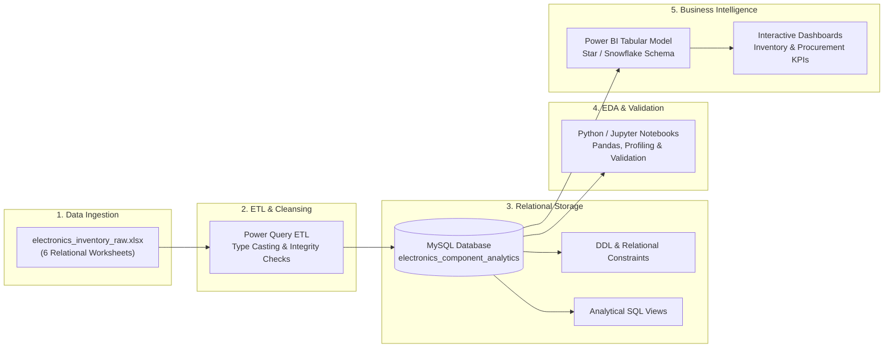
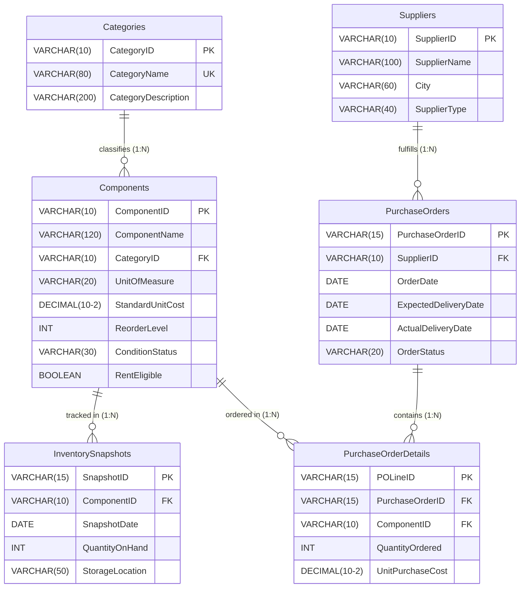

# Electronics Component Inventory & Procurement Analytics

[](04_MySQL/)
[](05_Python/)
[](06_Power_BI/)
[-green.svg)](02_Dataset/)
[](LICENSE)

An end-to-end Data Analytics and Business Intelligence project simulating an electronics component distributor and small-scale electronics manufacturing business. The project consolidates disconnected inventory records and procurement logs into a normalized relational data model, analyzes operational health using **SQL** and **Python**, and delivers executive decision-support dashboards through **Power BI**.

---

## Executive Summary

| Attribute | Specification |
| :--- | :--- |
| **Project Type** | End-to-end Data Analytics & Business Intelligence Solution |
| **Industry Scenario** | Fictional Electronics Component Distributor & Small Manufacturing Enterprise |
| **Primary Users** | **Inventory Managers** & **Procurement Managers** |
| **Reporting Currency**| Indian Rupee (**INR - ₹**) |
| **Unit of Measurement**| **Piece** (standardized across all component categories) |
| **Data Authenticity** | **100% Synthetic** (Relational dataset created from scratch for simulation) |
| **Core Repositories** | MySQL Relational Store, Excel/Power Query ETL, Python EDA, Power BI Star Schema |

---

## Problem Statement

Electronics businesses manage thousands of discrete and integrated components across categories like resistors, capacitors, power semiconductors, sensors, microcontrollers, and interconnects. 

When operational records are maintained in isolated spreadsheets:
- **Stockout & Shortage Risks**: Identifying components below safety thresholds or experiencing zero stock requires reactive manual audits.
- **Inaccurate Inventory Valuation**: Calculating true inventory carrying value across volatile parts categories is slow and prone to errors.
- **Uncontrolled Procurement Spend**: Comparing purchase price variance across multiple vendors for identical parts is difficult without centralized purchasing analytics.
- **Supplier Delivery Bottlenecks**: Tracking supplier fulfillment delays, pending orders, and delivery lead times is time-consuming.

### Proposed Solution
This project implements an integrated analytical pipeline:
1. **Relational Data Modeling**: Structured into 6 normalized tables with strict primary/foreign keys.
2. **Power Query ETL**: Automated cleansing, null verification, and date parsing.
3. **MySQL Analytics**: Analytical queries and views answering operational business questions.
4. **Python Exploratory Analysis**: Statistical distribution profiling and metric cross-validation.
5. **Interactive Power BI Dashboards**: Executive-ready visualization with dynamic DAX KPI modeling.

---

## End-to-End Pipeline Architecture



---

## Relational Schema & Dataset Overview

The dataset is organized across **6 normalized tables** stored within [`02_Dataset/raw/electronics_inventory_raw.xlsx`](02_Dataset/raw/electronics_inventory_raw.xlsx):



### Table Specifications & Record Counts

| # | Table Name | Record Count | Primary Key | Foreign Keys | Role / Contents |
| :-: | :--- | :---: | :---: | :---: | :--- |
| 1 | [**`Categories`**](02_Dataset/data_dictionary.md#table-1--categories) | **8** | `CategoryID` | — | Component category master catalog |
| 2 | [**`Components`**](02_Dataset/data_dictionary.md#table-2--components) | **105** | `ComponentID` | `CategoryID` | Electronic parts catalog with standard unit costs (₹) |
| 3 | [**`Suppliers`**](02_Dataset/data_dictionary.md#table-3--suppliers) | **50** | `SupplierID` | — | Vendor profiles across Indian industrial hubs |
| 4 | [**`InventorySnapshots`**](02_Dataset/data_dictionary.md#table-4--inventorysnapshots) | **1,260** | `SnapshotID` | `ComponentID` | Monthly stock levels (105 parts × 12 months in 2025) |
| 5 | [**`PurchaseOrders`**](02_Dataset/data_dictionary.md#table-5--purchaseorders) | **100** | `PurchaseOrderID` | `SupplierID` | Order headers (Delivered: 80, Pending: 12, Cancelled: 8) |
| 6 | [**`PurchaseOrderDetails`**](02_Dataset/data_dictionary.md#table-6--purchaseorderdetails) | **125** | `POLineID` | `PurchaseOrderID`, `ComponentID` | Order line items with negotiated purchase prices (₹) |

---

## Analytical Modules & Business Questions

### Module A: Inventory Analytics (For Inventory Managers)
Focuses on warehouse stock availability, stockout risks, holding valuation, and category distribution:

1. **Catalog Breadth**: How many distinct electronic components are actively managed? *(105 components)*
2. **Total Stock Volume**: What is the total aggregate inventory quantity on hand?
3. **Category Concentration**: Which component categories hold the highest stock volumes?
4. **Reorder Threshold Alerts**: Which specific components are currently below their reorder points?
5. **Stockout Incident Tracking**: Which components have zero stock and represent immediate shortage risks?
6. **Total Inventory Valuation**: What is the total monetary holding value of inventory in INR (₹)?
7. **High-Value Categories**: Which component categories account for the largest capital allocation?
8. **Monthly Stock Trajectory**: How do stock levels and consumption trends evolve across monthly snapshot cycles?
9. **Rental Asset Fleet**: How many components are eligible for commercial rental equipment programs?

### Module B: Procurement Analytics (For Procurement Managers)
Evaluates supplier spend, purchase volume, delivery turnaround times, and fulfillment reliability:

1. **PO Volume**: How many total purchase orders were issued across the operational year? *(100 POs)*
2. **Net Procurement Spend**: What is the total spend on non-cancelled purchase orders?
3. **Top Vendor Expenditure**: Which suppliers capture the largest share of procurement budget?
4. **Frequently Procured Parts**: Which electronic components are reordered most frequently?
5. **Monthly Purchasing Trend**: How does procurement expenditure vary month-over-month?
6. **Fulfillment Status Pipeline**: What proportion of orders are Delivered, Pending, or Cancelled?
7. **Delivery Lead Time**: What is the average lead time (in days) between order placement and receipt?
8. **On-Time Delivery Rate (OTD %)**: What percentage of delivered purchase orders arrived on or before schedule?
9. **Supplier Price Variance**: How do negotiated purchase prices for identical parts vary across different suppliers?

---

## Core KPI Definitions & Formulas

```text
┌────────────────────────────────────────────────────────────────────────────────────────┐
│                                KEY BUSINESS METRICS                                    │
├────────────────────────────────────────────────────────────────────────────────────────┤
│ 1. Current Inventory Valuation (₹)                                                     │
│    Valuation = SUM( QuantityOnHand * StandardUnitCost )                                 │
│                                                                                        │
│ 2. Stock Health Status                                                                 │
│    - Zero Stock  : QuantityOnHand = 0                                                  │
│    - Low Stock   : QuantityOnHand > 0 AND QuantityOnHand < ReorderLevel                │
│    - Healthy     : QuantityOnHand >= ReorderLevel                                      │
│                                                                                        │
│ 3. Purchase Order Spend (₹)                                                            │
│    Total Spend = SUM( QuantityOrdered * UnitPurchaseCost ) [OrderStatus <> 'Cancelled']│
│                                                                                        │
│ 4. Supplier Delivery Lead Time (Days)                                                  │
│    Lead Time = DATEDIFF( OrderDate, ActualDeliveryDate, DAY ) [OrderStatus = 'Delivered']│
│                                                                                        │
│ 5. On-Time Delivery Rate (OTD %)                                                       │
│    OTD % = ( Delivered Orders with ActualDate <= ExpectedDate / Total Delivered ) * 100 │
└────────────────────────────────────────────────────────────────────────────────────────┘
```

---

## Repository Structure

```text
Electronics-Component-Analytics/
│
├── .gitignore                           # Git ignore rules for virtual environments, temp files & data
├── README.md                            # Comprehensive project overview & documentation
├── PROJECT_CONTEXT.md                   # Business domain context, personas & system goals
│
├── 01_Project_Planning/
│   ├── project_overview.md              # Project scope, stakeholders & synthetic data disclaimer
│   ├── problem_statement.md             # Background, operational challenges & BI solution
│   ├── business_requirements.md         # Detailed breakdown of Modules A & B + 18 questions
│   ├── project_scope.md                 # Scope matrix (in-scope vs excluded operational areas)
│   └── project_phases.md                # 7-phase delivery roadmap from planning to deployment
│
├── 02_Dataset/
│   ├── raw/
│   │   ├── .gitkeep
│   │   └── electronics_inventory_raw.xlsx # Raw source workbook (6 relational sheets)
│   ├── processed/
│   │   └── .gitkeep                     # Output directory for cleaned/transformed datasets
│   └── data_dictionary.md               # Full schema definitions, constraints & ER diagram
│
├── 03_Power_Query/
│   └── transformation_documentation.md  # ETL cleansing rules, type casting & null handling
│
├── 04_MySQL/
│   ├── .gitkeep
│   ├── 01_create_database.sql           # Database initialization script
│   ├── 02_create_tables.sql             # DDL script with PK, FK, and unique constraints
│   ├── 03_import_data.sql               # Data loading scripts / bulk import queries
│   ├── 04_data_validation.sql           # Integrity verification, uniqueness & null checks
│   ├── 05_inventory_analysis.sql        # Stockout, valuation & ABC analysis queries
│   ├── 06_procurement_analysis.sql      # Vendor spend, lead times & OTD queries
│   └── 07_views.sql                     # Reporting views for Power BI ingestion
│
├── 05_Python/
│   ├── .gitkeep
│   ├── 01_data_profiling.ipynb          # Missing value audits & distribution profiling
│   ├── 02_exploratory_analysis.ipynb    # Visual EDA and supplier price variance analysis
│   └── 03_metric_validation.ipynb       # Mathematical cross-validation against SQL results
│
├── 06_Power_BI/
│   ├── Electronics_Inventory_Procurement.pbix # Interactive dashboard file
│   ├── dax_measures.md                  # Comprehensive catalog of DAX formulas
│   └── data_model_documentation.md      # Star schema design, relationships & cardinalities
│
├── 07_Documentation/
│   ├── data_quality_report.md           # Source dataset quality and integrity assessment
│   ├── sql_documentation.md             # Technical catalog of SQL queries and execution notes
│   ├── analysis_findings.md             # Summary of key inventory and supplier findings
│   ├── business_recommendations.md      # Actionable strategies for inventory and procurement
│   └── limitations.md                   # Project boundaries and future enhancement roadmap
│
├── 08_Presentation/
│   ├── .gitkeep
│   └── project_presentation.pptx        # Executive stakeholder presentation slide deck
│
└── 09_Screenshots/
    ├── data_model/                      # Screenshots of Power BI & MySQL schema models
    ├── sql/                             # Query execution output screenshots
    └── dashboard/                       # Power BI report page captures
```

---

## Tech Stack & Tooling

- **Source Storage**: Microsoft Excel (`openpyxl`)
- **Data Transformation & ETL**: Power Query
- **Relational Database**: MySQL 8.0 Community Server / Workbench
- **Statistical Analytics & EDA**: Python 3.10+ (`pandas`, `numpy`, `matplotlib`, `seaborn`, `jupyter`)
- **Business Intelligence & Reporting**: Microsoft Power BI Desktop
- **Version Control & Documentation**: Git, GitHub, Markdown, Mermaid.js

---

## Quickstart & Replication Guide

### 1. Clone the Repository
```bash
git clone https://github.com/shashaank747/Electronics-Component-Analytics.git
cd Electronics-Component-Analytics
```

### 2. Inspect Raw Datasets
Open [`02_Dataset/raw/electronics_inventory_raw.xlsx`](02_Dataset/raw/electronics_inventory_raw.xlsx) to inspect the 6 relational sheets:
- `Categories`
- `Components`
- `Suppliers`
- `InventorySnapshots`
- `PurchaseOrders`
- `PurchaseOrderDetails`

### 3. Initialize MySQL Database
Run the DDL and import scripts in MySQL Workbench or CLI:
```bash
mysql -u root -p < 04_MySQL/01_create_database.sql
mysql -u root -p < 04_MySQL/02_create_tables.sql
mysql -u root -p < 04_MySQL/03_import_data.sql
mysql -u root -p < 04_MySQL/04_data_validation.sql
```

### 4. Run Python Exploratory Analysis
```bash
pip install -r requirements.txt # (pandas, openpyxl, jupyter, matplotlib)
jupyter notebook 05_Python/
```

### 5. Open Power BI Dashboard
Open [`06_Power_BI/Electronics_Inventory_Procurement.pbix`](06_Power_BI/) in Microsoft Power BI Desktop to explore interactive visual reports, cross-filtering, and DAX KPI measures.

---

## Scope & Disclaimers

> [!NOTE]
> **Synthetic Data Disclaimer**: All records in this repository are 100% synthetic and generated specifically for data modeling and educational demonstration. No proprietary, sensitive, or real company data is used.

### In-Scope vs Excluded
- **In-Scope**: Descriptive & diagnostic inventory analytics, supplier performance comparison, lead time tracking, inventory valuation in INR (₹), interactive dashboards.
- **Excluded**: Real-time ERP transaction processing, live WMS barcode/RFID scanning, manufacturing line defect analysis, and machine-learning predictive forecasting.
