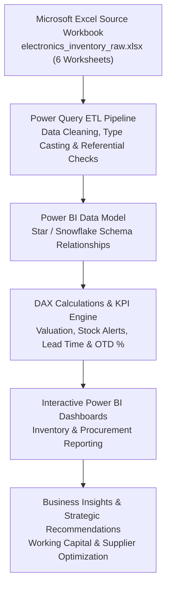
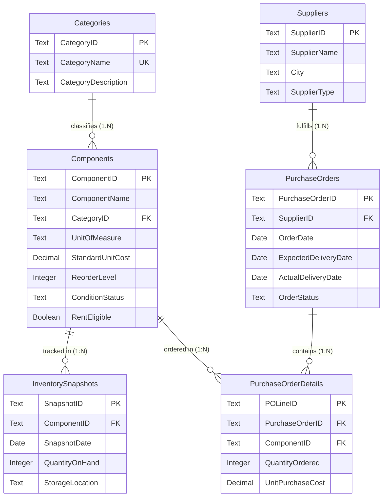

# Electronics Component Inventory & Procurement Analytics

[](02_Dataset/raw/)
[](03_Power_Query/)
[](04_Power_BI/)
[](04_Power_BI/dax_measures.md)
[-success.svg)](02_Dataset/)
[](LICENSE)

An end-to-end Data Analytics and Business Intelligence project simulating an electronics component distributor and small-scale electronics manufacturing business. The project consolidates disconnected inventory records and procurement logs from **Microsoft Excel**, cleanses and transforms the data using **Power Query**, models star-schema relationships in **Microsoft Power BI**, and delivers executive decision-support dashboards powered by **DAX**.

---

## Executive Summary

| Attribute | Specification |
| :--- | :--- |
| **Project Type** | End-to-end Data Analytics & Business Intelligence Solution |
| **Industry Scenario** | Fictional Electronics Component Distributor & Small Manufacturing Enterprise |
| **Primary Users** | **Inventory Managers** & **Procurement Managers** |
| **Reporting Currency**| Indian Rupee (**INR - ₹**) |
| **Unit of Measurement**| **Piece** (standardized across all component categories) |
| **Data Authenticity** | **100% Synthetic** (Relational dataset created from scratch for simulation) |
| **Core Architecture** | Microsoft Excel $\rightarrow$ Power Query $\rightarrow$ Power BI Data Model $\rightarrow$ DAX Measures $\rightarrow$ Dashboards |

---

## Technology Stack

This project is built strictly using the modern Microsoft Business Intelligence stack:

| Purpose | Technology |
| :--- | :--- |
| **Source Data** | Microsoft Excel |
| **Data Cleaning and ETL** | Power Query |
| **Data Modelling** | Microsoft Power BI |
| **Calculations** | DAX (Data Analysis Expressions) |
| **Visualization** | Microsoft Power BI |

---

## Problem Statement & Proposed Solution

### The Challenge
Electronics businesses manage thousands of discrete and integrated components across categories like resistors, capacitors, power semiconductors, sensors, microcontrollers, and electromechanical parts. 

When operational records are maintained in isolated spreadsheets:
- **Stockout & Shortage Risks**: Identifying components below safety thresholds or experiencing zero stock requires reactive manual audits.
- **Inaccurate Inventory Valuation**: Calculating true inventory carrying value across volatile parts categories is slow and prone to errors.
- **Uncontrolled Procurement Spend**: Comparing purchase price variance across multiple vendors for identical parts is difficult without centralized purchasing analytics.
- **Supplier Delivery Bottlenecks**: Tracking supplier fulfillment delays, pending orders, and delivery lead times is time-consuming.

### Proposed Solution
This project implements an integrated analytical pipeline:
1. **Relational Data Management**: Six normalized tables maintained in a structured Microsoft Excel workbook.
2. **Power Query ETL**: Automated data ingestion, cleansing, type casting, date normalization, and referential validation.
3. **Power BI Data Modelling**: Star/snowflake schema design with single-direction filter propagation and conformed dimensions.
4. **DAX KPI Engine**: Robust measures for valuation, safety stock alerts, supplier lead time, and on-time fulfillment rates.
5. **Interactive Executive Dashboards**: Role-tailored dashboards for Inventory and Procurement leadership with dynamic cross-filtering and drill-through capabilities.

---

## End-to-End Workflow & Architecture



---

## Relational Schema & Dataset Overview

The dataset is organized across **6 normalized tables** stored within [`02_Dataset/raw/electronics_inventory_raw.xlsx`](02_Dataset/raw/electronics_inventory_raw.xlsx):



### Table Specifications & Live Record Counts

| # | Table Name | Record Count | Primary Key | Foreign Keys | Role / Contents |
| :-: | :--- | :---: | :---: | :---: | :--- |
| 1 | [**`Categories`**](02_Dataset/data_dictionary.md#table-1-categories) | **8** | `CategoryID` | — | Component category master catalog |
| 2 | [**`Components`**](02_Dataset/data_dictionary.md#table-2-components) | **105** | `ComponentID` | `CategoryID` | Electronic parts catalog with standard unit costs (₹) |
| 3 | [**`Suppliers`**](02_Dataset/data_dictionary.md#table-3-suppliers) | **50** | `SupplierID` | — | Vendor profiles across Indian industrial hubs |
| 4 | [**`InventorySnapshots`**](02_Dataset/data_dictionary.md#table-4-inventorysnapshots) | **1,260** | `SnapshotID` | `ComponentID` | Monthly stock levels (105 parts × 12 months in 2025) |
| 5 | [**`PurchaseOrders`**](02_Dataset/data_dictionary.md#table-5-purchaseorders) | **100** | `PurchaseOrderID` | `SupplierID` | Order headers (Delivered: 80, Pending: 12, Cancelled: 8) |
| 6 | [**`PurchaseOrderDetails`**](02_Dataset/data_dictionary.md#table-6-purchaseorderdetails) | **125** | `POLineID` | `PurchaseOrderID`, `ComponentID` | Order line items with negotiated purchase prices (₹) |

---

## Analytical Modules & Business Questions Answered

### Module A: Inventory Analytics (For Inventory Managers)
Focuses on warehouse stock availability, stockout risks, holding valuation, and category distribution:

1. **Catalog Breadth**: How many distinct electronic components are actively managed? *(105 components)*
2. **Total Stock Volume**: What is the total aggregate inventory quantity on hand?
3. **Category Concentration**: Which component categories hold the highest stock volumes?
4. **Reorder Threshold Alerts**: Which specific components are currently below their reorder points?
5. **Stockout Incident Tracking**: Which components have zero stock and represent immediate shortage risks?
6. **Total Inventory Valuation**: What is the total monetary holding value of inventory in INR (₹)?
7. **High-Value Categories**: Which component categories account for the largest capital allocation?
8. **Monthly Stock Trajectory**: How do stock levels and consumption trends evolve across monthly snapshot cycles?
9. **Rental Asset Fleet**: How many components are eligible for commercial rental equipment programs?

### Module B: Procurement Analytics (For Procurement Managers)
Evaluates supplier spend, purchase volume, delivery turnaround times, and fulfillment reliability:

1. **PO Volume**: How many total purchase orders were issued across the operational year? *(100 POs)*
2. **Net Procurement Spend**: What is the total spend on non-cancelled purchase orders?
3. **Top Vendor Expenditure**: Which suppliers capture the largest share of procurement budget?
4. **Frequently Procured Parts**: Which electronic components are reordered most frequently?
5. **Monthly Purchasing Trend**: How does procurement expenditure vary month-over-month?
6. **Fulfillment Status Pipeline**: What proportion of orders are Delivered, Pending, or Cancelled?
7. **Delivery Lead Time**: What is the average lead time (in days) between order placement and receipt?
8. **On-Time Delivery Rate (OTD %)**: What percentage of delivered purchase orders arrived on or before schedule?
9. **Supplier Price Variance**: How do negotiated purchase prices for identical parts vary across different suppliers?

---

## Core KPI Definitions & DAX Formulas

```text
┌────────────────────────────────────────────────────────────────────────────────────────┐
│                              KEY DAX BUSINESS METRICS                                  │
├────────────────────────────────────────────────────────────────────────────────────────┤
│ 1. Current Inventory Valuation (₹)                                                     │
│    Inventory Valuation =                                                               │
│        SUMX( InventorySnapshots,                                                       │
│            InventorySnapshots[QuantityOnHand] * RELATED( Components[StandardUnitCost] )│
│        )                                                                               │
│                                                                                        │
│ 2. Stock Condition Classifications                                                     │
│    - Zero Stock  : CALCULATE( DISTINCTCOUNT( InventorySnapshots[ComponentID] ),        │
│                              InventorySnapshots[QuantityOnHand] = 0 )                  │
│    - Low Stock   : Filter onOnHand > 0 AND QuantityOnHand < ReorderLevel                │
│    - Healthy     : Filter onOnHand >= ReorderLevel                                     │
│                                                                                        │
│ 3. Purchase Order Spend (₹)                                                            │
│    Total Procurement Spend =                                                           │
│        CALCULATE(                                                                      │
│            SUMX( PurchaseOrderDetails,                                                 │
│                PurchaseOrderDetails[QuantityOrdered] *                                 │
│                PurchaseOrderDetails[UnitPurchaseCost]                                  │
│            ),                                                                          │
│            PurchaseOrders[OrderStatus] <> "Cancelled"                                  │
│        )                                                                               │
│                                                                                        │
│ 4. Supplier Delivery Lead Time (Days)                                                  │
│    Average Lead Time =                                                                 │
│        AVERAGEX( FILTER( PurchaseOrders, PurchaseOrders[OrderStatus] = "Delivered" ),  │
│            DATEDIFF( PurchaseOrders[OrderDate],                                        │
│                      PurchaseOrders[ActualDeliveryDate], DAY )                         │
│        )                                                                               │
│                                                                                        │
│ 5. On-Time Delivery Rate (OTD %)                                                       │
│    OTD % = DIVIDE( [On-Time Delivered Orders], [Delivered Orders], 0 )                 │
└────────────────────────────────────────────────────────────────────────────────────────┘
```

---

## Repository Structure

```text
Electronics-Component-Analytics/
│
├── README.md                            # Comprehensive project overview & documentation
├── PROJECT_CONTEXT.md                   # Business domain context, personas & system goals
├── .gitignore                           # Git ignore rules for temporary files & local caches
│
├── 01_Project_Planning/
│   ├── project_overview.md              # Project scope, stakeholders & synthetic data disclaimer
│   ├── problem_statement.md             # Background, operational challenges & BI solution
│   ├── business_requirements.md         # Detailed breakdown of Modules A & B + 18 questions
│   ├── project_scope.md                 # Scope matrix (in-scope vs excluded operational areas)
│   └── project_phases.md                # 7-phase delivery roadmap from planning to deployment
│
├── 02_Dataset/
│   ├── raw/
│   │   ├── .gitkeep
│   │   └── electronics_inventory_raw.xlsx # Raw source workbook (6 relational sheets)
│   ├── processed/
│   │   └── .gitkeep                     # Output directory for cleaned/transformed datasets
│   └── data_dictionary.md               # Full schema definitions, constraints & ER diagram
│
├── 03_Power_Query/
│   └── transformation_documentation.md  # ETL cleansing rules, type casting & null handling
│
├── 04_Power_BI/
│   ├── Electronics_Inventory_Procurement.pbix # Interactive dashboard file
│   ├── dax_measures.md                  # Comprehensive catalog of DAX formulas
│   └── data_model_documentation.md      # Star schema design, relationships & cardinalities
│
├── 05_Documentation/
│   ├── data_quality_report.md           # Source dataset quality and integrity assessment
│   ├── analysis_findings.md             # Summary of key inventory and supplier findings
│   ├── business_recommendations.md      # Actionable strategies for inventory and procurement
│   └── limitations.md                   # Project boundaries and future enhancement roadmap
│
├── 06_Presentation/
│   ├── .gitkeep
│   ├── project_presentation.pptx        # Executive stakeholder presentation slide deck
│   └── Electronics Component Inventory and Procurement Analysis Dashboard.pptx
│
└── 07_Screenshots/
    ├── data_model/                      # Screenshots of Power BI data model diagram
    └── dashboard/                       # Power BI report page captures
```

---

## Quickstart & Replication Guide

### 1. Clone the Repository
```bash
git clone https://github.com/shashaank747/Electronics-Component-Analytics.git
cd Electronics-Component-Analytics
```

### 2. Inspect Raw Datasets in Microsoft Excel
Open [`02_Dataset/raw/electronics_inventory_raw.xlsx`](02_Dataset/raw/electronics_inventory_raw.xlsx) to review the 6 relational worksheets:
- `Categories`: 8 category definitions
- `Components`: 105 component items with standard costs in Rupee (₹)
- `Suppliers`: 50 supplier records across industrial cities
- `InventorySnapshots`: 1,260 monthly observations across 2025
- `PurchaseOrders`: 100 purchase orders (Delivered, Pending, Cancelled)
- `PurchaseOrderDetails`: 125 line items with negotiated purchase prices (₹)

### 3. Review Power Query ETL Transformations
Refer to [`03_Power_Query/transformation_documentation.md`](03_Power_Query/transformation_documentation.md) for detailed M-language steps, type coercion, and null handling rules.

### 4. Open the Power BI Dashboard
1. Launch **Microsoft Power BI Desktop**.
2. Open [`04_Power_BI/Electronics_Inventory_Procurement.pbix`](04_Power_BI/Electronics_Inventory_Procurement.pbix).
3. If prompted to refresh data, confirm source points to `02_Dataset/raw/electronics_inventory_raw.xlsx`.
4. Interact with the multi-page dashboards:
   - **Page 1: Inventory Analytics Dashboard** (Valuation, stockout risk, category allocation, monthly trajectory)
   - **Page 2: Procurement Analytics Dashboard** (Spend by supplier, lead time analysis, on-time delivery rate, order status breakdown)

---

## Project Scope & Deliverables

> [!NOTE]
> **Synthetic Data Disclaimer**: All records in this repository are 100% synthetic and generated specifically for data modeling and educational demonstration. No proprietary, sensitive, or real company data is used.

### In-Scope vs Excluded
- **In-Scope**: Descriptive & diagnostic inventory analytics, supplier performance comparison, lead time tracking, inventory valuation in INR (₹), Power BI interactive dashboards.
- **Excluded**: Real-time ERP transaction processing, live database servers, live WMS barcode/RFID scanning, manufacturing line defect analysis, and machine-learning predictive forecasting.
